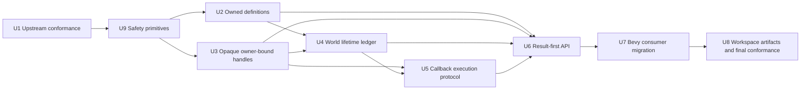
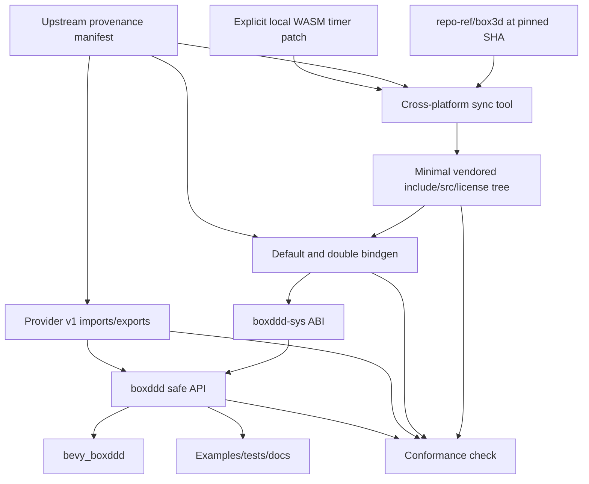
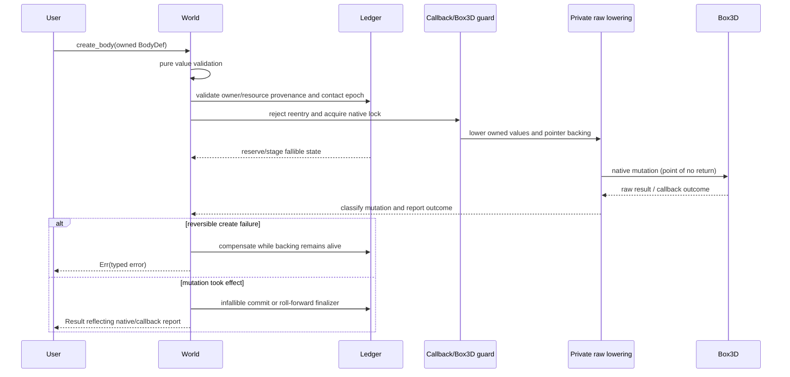
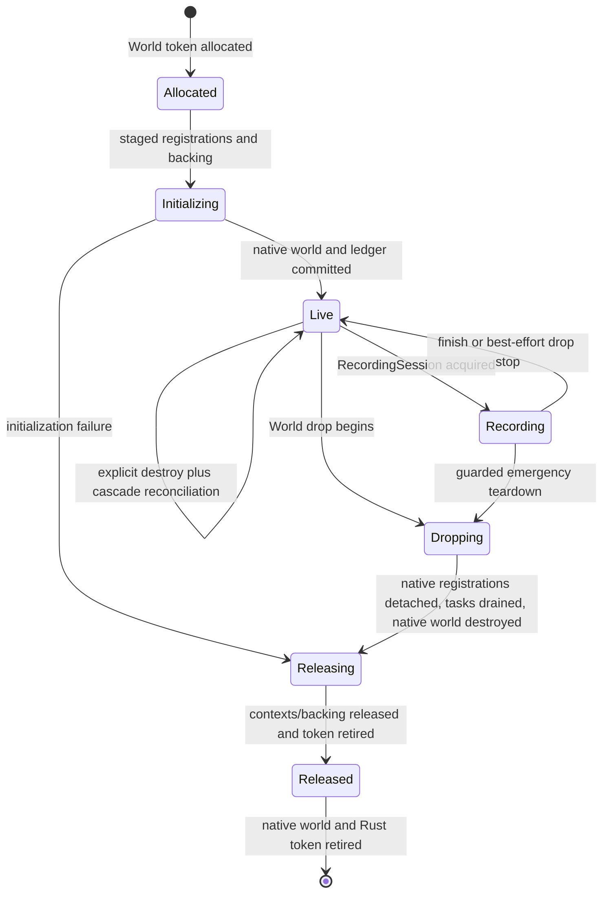
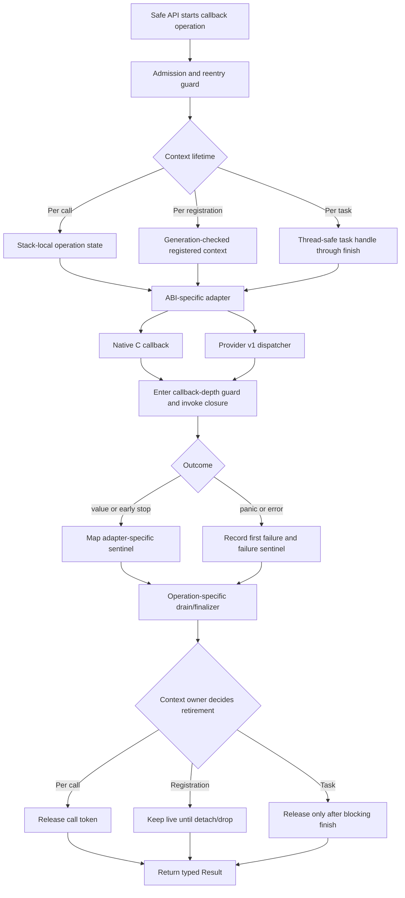

# Deepen Box3D Rust Binding Architecture - Plan

## Goal Capsule

| Field | Decision |
|---|---|
| Objective | Turn `boxddd` into a sound, Rust-native Box3D binding whose upstream provenance, owned configuration values, handle authority, native lifetimes, callback behavior, fallibility, and downstream integrations are explicit and mechanically verified. |
| Authority | The local upstream clone at `repo-ref/box3d`, pinned to commit `781673be801569a94be7942848755fc0baad3653`, is the semantic and source reference. Checked-in vendored sources, generated bindings, provider ABI, tests, and documentation are the repository deliverables. |
| Execution profile | Breaking changes and deletion are expected. Prefer one sound primary API over compatibility shims, panic facades, exposed ABI layouts, duplicated callback machinery, or forwarding-only extension traits. |
| Stop conditions | Stop only after all nine implementation units satisfy their local definition of done and the native, double-precision, bindgen, provider/WASM, Bevy, documentation, package, and conformance gates pass or have a precisely documented external toolchain blocker. |
| Tail ownership | Implementation owns the feature branch, source and generated changes, tests, examples, English documentation, and reviewable Conventional Commits. Publishing, tagging, pushing, and opening a pull request are excluded. |

---

## Product Contract

### Summary

The current wrapper is broad but its safety model is shallower than its API surface. Several public `*Def` values embed C structs and borrowed pointers, IDs expose native layouts and can call Box3D without an owner guard, lifecycle sidecars are distributed across modules, recording uses process-global bookkeeping, callback trampolines duplicate panic and cleanup policy, and many fallible operations are split between panic-first and `try_*` variants.

This refactor establishes a single architectural rule: Rust owns values and authority; raw Box3D values exist only at a guarded FFI boundary. The work begins by synchronizing the upstream C source and ABI so the safe redesign targets the intended Box3D revision, then deepens the wrapper from the bottom up. The result is an intentional pre-1.0 API reset from the published `0.2.0` line toward `0.3.0`, with migration documentation instead of compatibility contracts that cannot be defended.

### Problem Frame

- `BodyDef` and similar values derive or implement ordinary Rust traits while internally carrying C pointers whose pointee lifetime is not represented by the type. In particular, cloning a raw-backed `BodyDef` copies its `name` pointer rather than rebasing it to cloned storage.
- Public ID fields, `from_raw`, `into_raw`, and ID-local `is_valid` turn inert values into unguarded native capabilities. A copied ID can race world mutation or accidentally target a native world slot that has been destroyed and reused.
- Shape backing, callback registrations, task state, provider tokens, debug state, and recording state have related lifetime obligations but no central transaction or teardown model.
- Callback adapters correctly contain many panics today, but admission, reentrancy, first-failure capture, early-stop mapping, cleanup, and post-call draining are implemented repeatedly and can drift across native, provider, and WASM paths.
- The safe surface exposes both panic-first methods and `try_*` methods for many operations, increasing documentation and migration cost while making failure behavior depend on which spelling a user discovers first.
- Upstream provenance is a prose claim. The update tool regenerates bindings from whatever is already vendored but does not synchronize a pinned tree, verify local patches, compare generated output, or assert provider ABI and semantic default parity.

### Actors

- Rust library users who expect safe methods to reject foreign, stale, or invalid handles without invoking undefined native behavior.
- Bevy users who need IDs to remain lightweight `Copy + Send + Sync` ECS data while the native `World` stays a non-send resource.
- Raw FFI users who need an explicit escape hatch with a clear statement of which mutations bypass safe invariants.
- Native, WASI source-mode, and browser provider-mode consumers who need the same public error contract where the platform can support it.
- Maintainers updating Box3D who need one reproducible command and one conformance contract instead of manually reconciling headers, bindings, safe wrappers, and provider imports.

### Requirements

**Upstream provenance and ABI conformance**

- R1. Vendor the declared runtime subset of Box3D commit `781673be801569a94be7942848755fc0baad3653`; remove unrelated upstream samples, benchmarks, generated documentation, and host-rendering dependencies from the vendored runtime tree.
- R2. Store the upstream repository, exact commit, vendored path inventory, header fingerprint, provider import module revision, binding modes, local patch fingerprints, required per-mode capability baseline, and compact official-sample inventory fingerprint in one machine-readable provenance manifest.
- R3. Replace the binding-only refresh script with a cross-platform synchronize/generate/check workflow that materializes the declared subset from the exact commit object, never from possibly dirty working-tree bytes; verifies repository and commit identity; applies only explicit local patches; regenerates both precision modes and the compact sample inventory; and fails on any non-reproducible diff.
- R4. Conformance checks must cover more than symbol counts: public function signatures, constants, layout and offsets, every raw lowering baseline and owner-independent safe-definition default/validation rule, provider imports/exports, and a manifest-owned per-mode classification of every public surface as required-supported or intentionally unsupported. Required support cannot silently downgrade. Owner-bound definitions do not preserve meaningless null-handle defaults merely to mirror C initialization.
- R5. Bump the browser provider import module when the upstream ABI changes and derive the module identifier from the provenance contract instead of repeating a string across build logic, runtime glue, tests, and documentation.

**Owned definitions and guarded lowering**

- R6. Public body, shape, world, explosion, and joint definitions must store Rust values and owned data only; they must not expose raw C backing, raw pointers, or a public `raw()` accessor.
- R7. `validate()` and builders must report pure value errors, including non-finite values, invalid ranges, negative damping or sleep thresholds, and interior NUL bytes, as typed `Result` failures without panicking.
- R8. World-bound lowering must additionally validate owner provenance for referenced IDs and create raw C storage whose lifetime is proven for the native call. Every pointer field must be classified as copied synchronously or retained by Box3D; retained backing belongs in the appropriate owner ledger.
- R9. The FFI boundary must repeat the relevant validation even for directly constructed public definitions so builders are ergonomic helpers, not the only safety barrier.

**Opaque handles and owner authority**

- R10. Safe World-owned handles (`BodyId`, `ShapeId`, `JointId`, and `ContactId`) must hide native fields and carry private, never-reused Rust owner and resource-instance tokens in addition to raw bits. The owner token prevents cross-World slot reuse; the resource token prevents same-World ABA after native generation wrap. Contact observations also carry the turnover epoch in which their instance token was resolved.
- R11. Safe World-owned handles remain inert `Copy + Eq + Hash + Send + Sync` values suitable for Bevy components and map keys. They do not invoke Box3D themselves; validity and all native operations are authorized by the owning `World`.
- R12. Dynamic-tree proxy IDs and the Recording/RecPlayer owner types included in this refactor use the same owner-plus-instance provenance principle with their actual owner rather than being forced through `World`. Any additional non-World resource class requires a separate named requirement.
- R13. Ordinary public APIs must not deserialize live native handles or expose safe raw constructors. A scoped raw guard permits observation and non-structural calls only. Complete native ownership transfer is consuming and yields an owning raw-parts bundle containing the native ID plus every ledger, retained-backing, callback, task, provider, and debug owner needed for later destruction or complete adoption; it never returns a naked native World ID. Structural adoption is explicit, resource-specific unsafe work that requires all relations and retained-backing metadata. No general mutable guard may claim to reconstruct safe invariants after arbitrary raw creation or destruction.

**World lifetime ledger and transactions**

- R14. A cohesive World-owned state object must hold owner/resource token allocation, raw-to-resource provenance, body/shape/joint membership, shape backing, contact turnover epoch, a synchronized callback-visible provenance index, callbacks, task/provider tokens, debug state, and active recording state.
- R15. Each mutation defines prepare, native point-of-no-return, and finalize phases. Fallible allocation and staging happen before native mutation; reversible create failures compensate while backing remains alive; irreversible destroy, step, and callback-reporting paths roll ledger state forward even when the Rust return value is `Err`. Body destruction must account for the complete native cascade of shapes, joints, and contacts.
- R16. Raw-to-safe conversion has three distinct authorities: successful safe creation allocates a never-reused resource token and commits membership, query/event/callback observation resolves an existing active or event-retired resource token without creating liveness, and explicit unsafe adoption allocates provenance only as part of a complete, rejectable reconciliation. Owner access validates both tokens and contact epoch before C. Stale event IDs remain readable inert values but subsequent operations return a typed invalid-handle error.
- R17. Replace process-global recording bookkeeping and manual start/stop pairing with a borrowing `RecordingSession` that permits world operations while active, has an explicit fallible finish path, and performs non-panicking best-effort cleanup on drop.
- R18. World teardown must release registrations and native state exactly once in a documented forward-only order without holding bookkeeping locks across user callbacks. Retained backing and callback/task/provider context remain alive until native references are detached, queued work is drained, and the native world is destroyed.

**Callback execution protocol**

- R19. Centralize callback admission, callback-depth guarding, first-failure capture, panic containment for unwind builds, early-stop mapping, RAII token cleanup, and post-call error draining in a shared execution protocol.
- R20. Keep ABI-specific native/provider adapters and distinguish stack-local callback state from thread-safe cross-worker state. One generic trampoline must not erase different lifetimes, sentinels, or concurrency guarantees.
- R21. When worker callbacks race, the winner is the first failure that successfully captures the invocation's atomic failure slot; that value remains stable for the invocation, while different executions may legitimately capture different concurrent failures. Task enqueue, worker, finish, and teardown paths remain exactly-once and blocking where Box3D requires it.
- R22. Provider mode must never cross a missing callback export or table entry. The manifest capability baseline determines which surfaces must work and which are intentionally unsupported; changing that classification requires explicit review. Unsupported surfaces return `Error::UnsupportedOnWasm`; provider `panic=abort` limitations are documented rather than claiming native unwind equivalence.

**Result-first public API and downstream migration**

- R23. A fallible operation owns its unprefixed public name and returns `Result`; delete the corresponding panic facade and redundant `try_*` twin. Preserve language-conventional names such as `TryFrom` and genuinely infallible value accessors.
- R24. Collapse duplicate public error aliases and keep one core error/result vocabulary with stable variants for invalid values, foreign/stale handles, callbacks, unsupported platforms, and native failures.
- R25. Preserve both event representations: owned snapshots for storage and closure-scoped zero-copy views for hot paths. Keep raw event access explicitly unsafe and owner-scoped.
- R26. Preserve `DebugDraw` and platform/provider adapters as real abstraction boundaries while moving shared execution policy beneath them.
- R27. Migrate every workspace crate, example, test, benchmark, rustdoc example, and generated/public document to the new contracts. Publish an explicit `0.2.0`-to-`0.3.0` migration guide and changelog section while providing no compatibility shims. Delete obsolete panic-path tests, raw-layout assumptions, compatibility helpers, and forwarding-only Bevy math extension traits.
- R28. Bevy IDs remain schedulable ECS components and `PhysicsWorld` remains non-send. Always emit `BoxdddErrorMessage`; remove library-owned panic policy so the host application decides whether to log, aggregate, recover, or terminate.

**Safety evidence and maintainability**

- R29. Native owners remain `!Send` and `!Sync`; only inert provenance-bearing IDs cross threads. Compile-time assertions and focused concurrency tests must make that boundary explicit.
- R30. Safety documentation must describe actual invariants and known raw escape costs. Replace the stale FFI lifetime audit conclusion and ensure coverage reports do not present symbol inventory as semantic safety proof.
- R31. The completed architecture must pass every locally available repository verification gate without compatibility shims, dead modules, duplicated callbacks, or unexplained generated diffs. An unavailable external target is acceptable only when its exact command and prerequisite are documented and no verification claim is made for it.

### Acceptance Examples

- AE1. Given a `BodyDef` with a name is cloned and the original is dropped, when the clone creates a body, then the name storage used at the FFI boundary is valid and belongs to the lowered call or World ledger as required by upstream retention semantics.
- AE2. Given a body definition has negative linear damping, angular damping, or sleep threshold, when it is built or passed to `World::create_body`, then a typed validation error is returned before Box3D is called.
- AE3. Given Box3D reuses a World slot or wraps a resource's 16-bit native generation inside one live World, when an old body ID is used, then Rust rejects its owner or resource-instance token before invoking an ID-dependent Box3D operation.
- AE4. Given a body owns multiple shapes and joints, when the body is destroyed, then all related ledger entries and backing allocations are removed exactly once and later operations on their IDs return stale/invalid errors.
- AE5. Given a recording session is active, when the caller steps or mutates the world through the session and then calls `finish`, then recording stops successfully and bytes become available; dropping an unfinished session performs non-panicking best-effort cleanup.
- AE6. Given a query callback requests early stop, panics under `panic=unwind`, or attempts reentrant mutation, when the native and provider-capable paths return, then tokens are released exactly once and the caller receives the appropriate stop outcome or typed error.
- AE7. Given task callbacks fail concurrently, when their failures are drained, then the first failure is stable, finish remains blocking, work items are completed exactly once, and no Rust panic crosses C.
- AE8. Given an operation can fail due to invalid state or native input, when a user calls its ordinary unprefixed name, then it returns `Result`; no parallel panic facade is present in the public docs.
- AE9. Given Bevy stores body and shape IDs as components, when systems schedule normally, then those IDs remain `Send + Sync`, native World access stays in the non-send resource, and failures become observable `BoxdddErrorMessage` values rather than library-triggered panics.
- AE10. Given a maintainer changes an upstream header, generated binding, provider module revision, default value, or local patch, when conformance check mode runs, then it reports the precise provenance or semantic mismatch and exits unsuccessfully.

### Scope Boundaries

- Future Box3D commits after `781673be801569a94be7942848755fc0baad3653` are not included. The workflow must make a future bump routine, but this plan does not track moving upstream `main`.
- This plan does not make `World`, `DynamicTree`, `Recording`, replay owners, or callback-hosting native state `Send` or `Sync`, and does not redesign Box3D's threading model.
- This plan does not collapse owned event snapshots and zero-copy event views into one representation.
- This plan does not delete `DebugDraw`, native ABI adapters, WASI source mode, or browser provider mode merely because they contain platform-specific code.
- This plan does not preserve source compatibility with published `0.2.0`, its raw ID layout, `try_*` naming, panic facades, recording start/stop pairing, live-handle serde representation, or Bevy forwarding traits; `0.3.0` migration documentation replaces compatibility shims.
- This plan does not promise recovery from `panic=abort`, nor does it emulate an unavailable provider callback surface.
- This plan does not publish crates, tag a release, push a branch, or open a pull request.

---

## Planning Contract

### Key Technical Decisions

- KTD1. Implement all six identified architecture areas in one dependency-ordered program. `(session-settled: user-approved - chosen over shipping only the highest-severity fixes or splitting the redesign, because the user requested every proposed improvement.)`
- KTD2. Break compatibility and delete unsound or redundant code rather than maintaining parallel legacy entry points. `(session-settled: user-directed - chosen over a deprecation cycle, because the user explicitly authorized breaking refactors and deletion.)`
- KTD3. Synchronize to exact upstream commit `781673be801569a94be7942848755fc0baad3653` before redesigning the safe API. This avoids implementing new invariants against obsolete C definitions and callback signatures.
- KTD4. Vendor only a declared runtime/build subset and represent the existing single-thread WASM timer modification as an explicit, fingerprinted patch. The checked-in result remains buildable; the workflow can prove both upstream identity and local deviation.
- KTD5. Model public `*Def` types as pure Rust owned values, then lower them into private raw storage at the guarded call site. Pointer retention is classified field by field; only proven synchronous-copy fields may use ephemeral backing. Owner-bound joint definitions require valid body handles at construction and do not implement a tokenless `Default`; upstream raw defaults remain a private lowering baseline.
- KTD6. Use one concurrency-safe, fail-closed provenance allocator for never-reused owner and resource-instance tokens. World-token allocation is the first creation reservation and burns on later failure; each native resource creation/adoption burns a distinct instance token before publication; neither domain wraps or reuses values. Safe IDs contain private native bits plus both tokens (and a contact epoch where applicable), stay `Copy + Send + Sync`, and gain native authority only when all provenance matches the owner ledger. This is chosen over lifetime-branded IDs because Bevy stores IDs independently of a World borrow, and over owner-token-only IDs because upstream 16-bit generations can wrap inside one live World.
- KTD7. Remove serde support for live IDs. Serialization of an ephemeral native capability is misleading; a future persistence feature should define stable snapshot identifiers instead of recreating raw Box3D IDs.
- KTD8. Centralize resource provenance and retained backing in a World lifetime ledger with explicit mutation classes. Creates reserve/stage before C and compensate a failed post-call commit; destroy and step snapshot the affected closure before C and roll forward after the point of no return, including when callback draining produces the returned error. The ledger distinguishes created membership, observed provenance, and adopted ownership; keeps event-retired provenance long enough to construct inert end-event IDs; and scopes contacts by turnover epoch. Worker callbacks receive a separately synchronized provenance index, copy lookup results, and release its short read guard before user code; no ledger write guard spans a native call.
- KTD9. Use `RecordingSession<'_>` as the recording contract. The session grants mutable World access while holding the Recording borrow, exposes an explicit fallible `finish`, and uses `Drop` only for non-panicking cleanup.
- KTD10. Share callback operation policy, not one cleanup tail or universal ABI trampoline. Context ownership has three classes: per-call state is drained after the native call, per-registration state survives until detach/World teardown, and per-task state survives enqueue through blocking finish. Local queries use stack-local state; task and concurrently entered registrations use synchronized first-failure state; platform adapters retain their signatures and failure sentinels.
- KTD11. Make `Result` the default contract for fallible operations and remove `try_*`/panic twins. `(session-settled: user-approved - chosen over retaining convenience panic facades as part of the approved fallibility redesign.)`
- KTD12. Preserve event snapshots plus scoped views, `DebugDraw`, and provider/native adapters because each is a genuine ownership or platform boundary rather than incidental duplication.
- KTD13. Keep the provider ABI manifest-driven and bump the final callback-capable contract to `box3d-sys-v2` so an old JS provider cannot silently satisfy a new Rust binding.
- KTD14. Do not expose a general structurally mutable raw World guard. Observation and non-structural calls may be scoped under the owner/callback/native guards. Complete transfer consumes World into an owning raw-parts bundle that retains all Rust sidecars and supplies unsafe destruction/complete adoption; a naked native ID is never presented as ownership. Structural adoption is resource-specific and rejected unless the caller supplies enough relations and retained backing to establish the ledger. Automatic post-guard scanning is rejected because Box3D cannot enumerate or reconstruct Rust-owned backing completely.

### Priority Order

1. **P0 - Upstream reproducibility:** establish the exact C source, local patch, generated binding, and provider ABI contract before changing safe layouts.
2. **P0 - Shared safety primitives:** fix the canonical error vocabulary and never-reused provenance allocation before definitions and handles consume them.
3. **P0 - Immediate soundness:** eliminate raw-backed definition pointers and ownerless native ID capabilities.
4. **P0 - Lifetime integrity:** centralize sidecars, cascade cleanup, recording ownership, and safe teardown.
5. **P1 - Callback consistency:** unify execution policy after owner guards and lifecycle state have a stable home.
6. **P1 - Public API coherence:** rename fallible operations only after their final error and ownership semantics are known.
7. **P1 - Ecosystem migration:** update Bevy, examples, tests, docs, provider smoke, and packages as one coordinated compatibility break.

### Dependency Graph

Conceptually independent audits may run in parallel, but source edits and Cargo verification are serialized because the units touch shared core modules and the development environment must avoid competing builds.

### High-Level Technical Design

#### Repository and conformance topology

The manifest is the single version contract. Build logic may consume a generated Rust constant derived from it, while the maintenance tool owns synchronization and comparison. The vendored tree contains the patched build input, but check mode reconstructs the declared upstream subset plus patch set in a temporary directory and compares it to the checked-in tree.

#### Guarded safe-call sequence

No safe handle method enters C on its own. All raw conversion and native validity checks occur after owner/resource provenance validation, callback admission, and the process-wide Box3D lock. An `Err` after an irreversible call does not imply that simulation state is unchanged; finalizers first restore ledger/native consistency, then report the error.

#### World lifetime ledger

The ledger owns a bidirectional relationship graph rather than a flat validity cache: `shape -> body`, `body -> shapes`, `joint -> {body_a, body_b}`, and `body -> joints`. Destroy finalizers operate on a pre-call closure and remove each edge once. Safe creation registers membership; queries, callbacks, and events only observe known values and attach provenance; unsafe adoption is a separate complete reconciliation. Contact IDs carry an epoch advanced by every contact-turnover mutation, including post-call error paths. Native validity remains a guarded diagnostic, not the source of owner identity.

#### Callback protocol and adapters

The common protocol owns admission, failure priority, and outcome reporting. Each context owner controls publication and retirement; each adapter owns ABI layout, closure bounds, native sentinel values, and provider availability. Registered tokens follow `Staged -> Live -> Detaching -> Draining -> Retired` with generation checks so late callbacks fail closed instead of reaching replacement storage.

### Assumptions

- The local clone's current commit is the intended upstream target even though it is ahead of the last tagged release. Pinning the exact SHA makes this deterministic.
- Live native IDs are not a supported persistence format. Removing their serde implementations is acceptable; stable scene or snapshot identifiers can be designed separately later.
- The current single-thread WASM timer patch remains necessary unless direct source and runtime verification proves the target commit has equivalent behavior.
- Box3D may retain some definition pointer fields. Implementation must inspect and test each field before choosing ephemeral backing; the plan does not assume that all definitions are copied.
- Monotonic nonzero owner and resource-instance tokens allocated by Rust can remain unique for the process lifetime; both domains fail closed on exhaustion rather than wrap or reuse a token.
- This breaking development line targets workspace version `0.3.0`; versioning and migration files change, but no release is published by this plan.
- No pull request, push, release tag, or publication is required. Local commits on a feature branch are authorized.

### System-Wide Impact

- **Build and source provenance:** `boxddd-sys` becomes smaller and reproducible; the provider ABI and generated bindings become explicit outputs of the same pinned contract.
- **Public types:** most `*Def` and ID layouts change, raw access narrows, serde support for live IDs disappears, and error-returning method names move to the primary spelling.
- **Runtime ownership:** World state becomes a deeper module responsible for native authorization, bidirectional membership, retained allocations, contact epochs, registration generations, recording, forward-only recovery, and teardown.
- **Callbacks:** query, event, shape visitor, dynamic-tree, debug draw, registered callback, task-system, and provider paths share failure/cleanup policy but retain appropriate adapters.
- **Bevy:** components remain lightweight and schedulable; non-send World access and message-based error observation become clearer; forwarding-only math APIs are removed.
- **Tests and docs:** tests shift from expected panics and exposed raw layouts toward compile-time ownership assertions, stale/foreign-token rejection, transaction rollback, cascade cleanup, and provider parity.

### Risks And Mitigations

| Risk | Consequence | Mitigation |
|---|---|---|
| The upstream sync is a large generated/vendor diff. | Review can hide accidental file loss or untracked local changes. | Restrict the declared vendor subset, compare from a temporary reconstruction, separate the sync commit, and review manifest/patch changes before generated output. |
| A definition pointer is retained by Box3D. | Ephemeral lowering would create a use-after-free. | Build a pointer-retention inventory from headers and C implementations; add targeted lifetime tests; store retained backing in the owner ledger. |
| Native World slots are reused or a resource's 16-bit generation wraps. | Owner-only or raw-only identity can authorize a stale handle. | Validate never-reused owner plus resource-instance tokens and test both cross-World reuse and same-World forced generation wrap. |
| The ledger misses cascade destruction or event-created IDs. | Sidecar backing leaks or reports false liveness. | Track membership relations, centralize all raw-to-safe conversion, reconcile documented native cascades, and test body/shape/joint/contact lifecycle combinations. |
| A Rust allocation or callback error occurs after an irreversible native mutation. | Native and ledger state diverge even though the API returned `Err`. | Reserve and stage all fallible state before C; snapshot destruction closures; use infallible post-call finalizers and fault injection to prove compensate-or-roll-forward behavior. |
| Query or end-event observation is treated as creation. | A destroyed object is reintroduced into live membership and can survive native slot reuse. | Separate create, observe, and adopt conversion authorities; observations attach provenance but never liveness; test stale end events across slot reuse. |
| Owner, resource, or callback registration tokens are reused. | A stale ID or late callback reaches a new resource, World, or closure through ABA reuse. | Burn owner/resource tokens permanently, generation-check registrations, fail closed on exhaustion, and retire callback storage only after native detach and queued-work drain. |
| A worker callback reads the non-`Sync` World ledger or holds a provenance lock through user code. | Concurrent callback entry aliases state unsafely or deadlocks on reentry. | Publish a synchronized callback-only provenance index, copy results under a short read guard, and release it before invoking user code. |
| Consuming raw handoff returns only a native ID. | Rust callback contexts or retained backing are freed too early or leaked permanently. | Transfer an owning raw-parts bundle with unsafe destruction and complete adoption; never represent native ID alone as ownership. |
| Teardown releases Rust context before native references disappear. | World destruction or a late task/callback dereferences freed backing. | Keep backing and contexts alive through detach, drain, and native world destruction; use destructor probes and a forward-only teardown phase marker. |
| A universal callback abstraction erases required differences. | Incorrect thread bounds, sentinels, or lifetimes. | Share execution policy only; keep local/shared state classes and explicit ABI adapters with focused tests. |
| Provider v1 cannot support every new callback surface. | Browser traps or false parity claims. | Generate/verify imports, guard every unsupported path, and return `UnsupportedOnWasm` before native/provider dispatch. |
| Result-first renaming touches hundreds of call sites. | Missed examples or docs compile failures. | Generate an API migration inventory, migrate module by module, compile rustdoc/examples, and delete old names so stale use fails loudly. |
| Recording RAII prevents normal world access. | Recording becomes unusable during simulation. | Make the session proxy mutable World access, keep explicit `finish`, and test stepping and mutation while recording. |
| Removing ID serde breaks downstream storage formats. | Existing user data cannot deserialize. | Treat this as an intentional breaking safety correction and document stable snapshots as the supported future direction. |

### Sources And Research

- `repo-ref/box3d` at `781673be801569a94be7942848755fc0baad3653`: target headers, C implementations, default values, pointer retention, callback signatures, and recording behavior.
- `boxddd-sys/build.rs`, `boxddd-sys/src/ffi.rs`, `boxddd-sys/provider/debug_callbacks.c`, and `xtask/src/main.rs`: current native/provider mode selection and duplicated provider module contract.
- `tools/update_box3d_and_bindings.py`: current binding-only refresh workflow and reproducibility gaps.
- `boxddd/src/types/ids.rs`, `boxddd/src/body.rs`, `boxddd/src/world.rs`, `boxddd/src/world/*`, and `boxddd/src/recording.rs`: current raw-backed definitions, public handle layouts, distributed sidecars, and global recording registry.
- `boxddd/src/callbacks.rs`, `boxddd/src/query.rs`, `boxddd/src/shapes.rs`, `boxddd/src/dynamic_tree.rs`, `boxddd/src/debug_draw.rs`, and `boxddd/src/core/task_system.rs`: current callback adapter and panic-containment inventory.
- `bevy_boxddd/src/components.rs`, `bevy_boxddd/src/resources.rs`, `bevy_boxddd/src/errors.rs`, and `bevy_boxddd/src/math.rs`: ECS handle requirements, non-send world ownership, error policy, and forwarding-only math surface.
- `docs/development/ffi-lifetime-audit.md`, `docs/platforms/wasm-callbacks.md`, `docs/api-coverage.md`, and the existing test suite: prior invariants, stale conclusions, and current verification vocabulary.

---

## Implementation Units

### U1. Reproducible Upstream Synchronization And Conformance

**Intent:** Make the exact Box3D source, local patch set, generated ABI, and provider contract reproducible before safe-layer work begins.

**Requirements:** R1-R5, R30

**Dependencies:** None.

**Primary files:**

- `boxddd-sys/box3d-upstream.toml`
- `boxddd-sys/third-party/box3d/`
- `boxddd-sys/patches/`
- `boxddd-sys/build.rs`
- `boxddd-sys/src/ffi.rs`
- `boxddd-sys/src/bindings_pregenerated.rs`
- `boxddd-sys/src/bindings_pregenerated_double.rs`
- `boxddd-sys/provider/debug_callbacks.c`
- `boxddd-sys/tests/layout.rs`
- `examples-wasm/provider-smoke/`
- compact generated sample inventory under `docs/upstream-parity/`
- `tools/update_box3d_and_bindings.py`
- `xtask/src/main.rs`
- provider loader/generated assets under `docs/pages/`
- `.github/workflows/`
- `docs/development/upstream-conformance.md`

**Approach:**

- Record the target repository and SHA, a minimal runtime vendor allowlist, normalized header hash, explicit patch files and hashes, generated binding modes, provider ABI revision, required per-mode capability baseline, and official-sample inventory fingerprint in one manifest.
- Audit the current vendored timer change against the target C source. Extract a minimal patch with an English rationale instead of treating a modified vendor file as upstream-identical.
- Deepen the Python tool into `sync`, `generate`, and `check` operations. Resolve and materialize bytes from the configured repository's exact commit object so dirty checkout files cannot enter the upstream layer. Check mode reconstructs a temporary tree, applies patches, regenerates both binding modes and a compact official-sample inventory, and compares declared outputs without writing the workspace.
- Remove upstream benchmark, sample host, renderer, generated docs, data, and other files not used to compile or license the runtime. Keep only the manifest-declared subset.
- Regenerate bindings from the synchronized headers, adapt safe/sys compilation to upstream signature changes, and migrate every provider ABI consumer, loader/generated asset, smoke fixture, CI assertion, and document to the manifest-driven provider namespace in this unit.
- Extend layout tests and xtask coverage with field offsets, full definition defaults, representative by-value ABI calls, provider import/export parity, and the manifest-owned required-supported/intentionally-unsupported matrix per feature/target mode. A support downgrade changes the reviewed manifest rather than disappearing behind `UnsupportedOnWasm`.
- Change sample-parity tooling to consume the compact generated inventory instead of the pruned vendored sample tree. In CI, checkout the configured upstream repository at the exact SHA into a temporary source directory, verify its resolved commit, and pass it to conformance checks.

**Invariants:**

- The checked-in vendor tree equals the declared upstream subset plus explicit patches.
- Neither build logic nor provider glue contains an independent hard-coded upstream/provider version.
- Check mode is read-only and produces a precise mismatch report.
- Working-tree dirt cannot change synchronized upstream bytes, and sample parity remains authoritative after upstream samples are removed from the package tree.

**Test scenarios:**

- A clean sync from the pinned local clone reproduces the checked-in vendor tree and both generated binding files byte-for-byte.
- A dirty modification in the local upstream checkout is ignored unless represented by a declared patch; a missing/wrong commit fails before synchronization.
- Changing one header, patch, generated binding, default expectation, or provider import makes check mode fail with the affected category.
- Default and double precision compile against the new headers; provider smoke cannot load the previous v0 module accidentally.

**Verification:**

- `python tools/update_box3d_and_bindings.py check --source repo-ref/box3d --mode both`
- `cargo nextest run -p boxddd-sys --test layout`
- `BOXDDD_SYS_FORCE_BINDGEN=1 BOXDDD_SYS_SKIP_CC=1 cargo check -p boxddd-sys --features bindgen`
- `BOXDDD_SYS_FORCE_BINDGEN=1 BOXDDD_SYS_SKIP_CC=1 cargo check -p boxddd-sys --no-default-features --features "bindgen,double-precision"`
- `cargo run -p xtask -- provider-smoke`

**Definition of done:** The pinned commit object and patch provenance are machine-verifiable independent of checkout dirt; obsolete vendor content is gone; compact sample and per-mode capability baselines preserve existing gates; CI provisions the exact source; both bindings, layouts, defaults, and provider v2 revision 2 contract agree with the target headers.

### U9. Canonical Error And Provenance Primitives

**Intent:** Establish the shared failure vocabulary and collision-free token mechanism that U2-U5 require, without coupling those modules back to one another.

**Requirements:** R10-R12, R24, R29

**Dependencies:** U1.

**Primary files:**

- `boxddd/src/error.rs`
- focused new internal modules under `boxddd/src/core/`
- `boxddd/src/lib.rs`
- compile-time and allocator-focused tests under `boxddd/tests/` or module tests

**Approach:**

- Establish the canonical `Error`/`Result` taxonomy and Result-first naming rule before later units add validation, provenance, lifecycle, callback, and provider failures. Keep U6 responsible only for completing the public inventory and deleting transitional names.
- Implement one internal monotonic provenance-token facility with separate owner/resource domains or equivalent collision-proof typing. Allocation is concurrency-safe, nonzero, burn-on-failure, never-wrap, never-reuse, and reports a typed exhaustion error.
- Make the allocator injectable or parametrically bounded in tests so last-value, overflow, concurrency, and burn behavior can be proven without relying on impractical process-wide exhaustion.
- Define internal token roles and comparison rules without exposing constructors or creating native authority in this unit.

**Invariants:**

- Every later failure path has one canonical error variant before public APIs migrate.
- Owner and resource tokens cannot collide across domains, wrap, recycle, or be fabricated through safe public APIs.
- Exhaustion is detected before the native mutation that would require the token.

**Test scenarios:**

- Concurrent allocation produces unique nonzero tokens.
- A bounded allocator returns its last valid value once, then reports exhaustion forever without wrapping.
- Tokens staged for deliberately failed initialization remain burned.
- Compile-time assertions preserve inert token `Send + Sync` behavior without making native owners sendable.

**Verification:**

- focused allocator/error module tests
- `cargo nextest run -p boxddd --test result_api`

**Definition of done:** Canonical errors and collision-free owner/resource token primitives are stable, exhaustively tested, and ready for U2/U3 integration without either unit depending on the other's implementation.

### U2. Pure Rust Definitions And Private Raw Lowering

**Intent:** Remove C pointers and ABI storage from reusable public configuration values.

**Requirements:** R6-R9, R23-R24

**Dependencies:** U9.

**Primary files:**

- `boxddd/src/body.rs`
- `boxddd/src/shapes.rs`
- `boxddd/src/world.rs`
- `boxddd/src/joints/defs.rs`
- `boxddd/src/types.rs`
- `boxddd/src/error.rs`
- `boxddd/src/core/`
- definition-focused tests and rustdoc examples under `boxddd/tests/` and `boxddd/src/`

**Approach:**

- Inventory every field in `b3WorldDef`, `b3BodyDef`, `b3ShapeDef`, `b3ExplosionDef`, and every joint definition at the pinned upstream revision.
- Replace raw-backed public values with idiomatic Rust fields, enums, owned strings, optional callbacks/configuration handles, and documented defaults. Remove public raw getters and raw-struct equality/debug behavior.
- Separate pure `validate()` checks from owner-dependent lowering checks. Builders return `Result`; direct World entry points repeat pure validation. This unit defines the ownership-check seam, while U3 supplies handle provenance and U4 completes retained/contextual lowering.
- Extend U9's canonical error taxonomy with structured validation context instead of panicking on interior NUL or invalid ranges; defer only the workspace-wide removal inventory to U6.
- Introduce private lowering storage per definition family. Audit C implementations to classify every pointer as synchronous-copy or retained. This unit proves synchronous-call storage; U4 owns retained backing and its destruction-lifetime tests.

**Invariants:**

- Cloning or moving a public definition cannot invalidate any internal pointer because no public definition stores a C pointer.
- A raw definition and all synchronous-call pointer backing outlive the complete native call that consumes it; retained fields are staged for U4 ownership rather than published through an incomplete API.
- Builder use is never required for safety.

**Test scenarios:**

- Clone/drop/move named definitions before creation and verify native names/defaults remain correct.
- Reject NaN/infinity, invalid ranges, negative damping, negative sleep threshold, and interior NUL without calling C; foreign referenced-ID rejection is proven after U3 provenance integrates in U4.
- Compare every Rust default to `b3Default*Def` at runtime for both precision modes.
- Compare owner-independent Rust defaults and private joint/raw lowering baselines to upstream without introducing tokenless default handles.

**Verification:**

- focused new definition/lowering tests, either in a dedicated `definitions` target or the existing owning module targets
- `cargo nextest run -p boxddd --test world_runtime`
- `cargo nextest run -p boxddd --test joints`
- focused definition/default tests selected by `cargo nextest run -p boxddd -E 'test(/def|default|validation/)'`

**Definition of done:** All public definitions are Rust-owned, synchronous unsafe lowering is private, every pointer is retention-classified for U4, the canonical error taxonomy is in use, and applicable validation/default parity is demonstrated against the pinned upstream revision.

### U3. Opaque Provenance-Bearing Handles And Scoped Raw Interop

**Intent:** Make IDs inert values and make their actual owners the only safe native capability.

**Requirements:** R10-R13, R16, R29

**Dependencies:** U9.

**Primary files:**

- `boxddd/src/types/ids.rs`
- `boxddd/src/world.rs`
- `boxddd/src/world/*`
- `boxddd/src/dynamic_tree.rs`
- `boxddd/src/recording.rs`
- `boxddd/src/raw.rs`
- `boxddd/src/interop.rs`
- `boxddd/src/events.rs`
- `boxddd/src/query.rs`
- `boxddd/src/lib.rs`
- `boxddd/src/prelude.rs`

**Approach:**

- Integrate U9's private provenance tokens into World construction and resource publication. Store native bits plus owner and resource-instance tokens in World-owned IDs; contacts also store their turnover epoch. Define the corresponding owner/instance provenance for dynamic-tree proxies and recording/replay owners.
- Remove public fields, `repr(C)` promises, safe raw constructors/conversions, ID-local native methods, and live-ID serde implementations.
- Separate internal constructors by authority: safe creation burns a resource token and produces a candidate membership value for U4 commit, while queries, event views/snapshots, and callbacks resolve an existing active or retired-event token. Unknown observations do not invent authority. Contact observations also capture the current epoch.
- Move validity checks and all operations to the owner. Validate the Rust token before acquiring the Box3D lock and making any native ID call.
- Replace ordinary raw world/ID access with a scoped unsafe observation/non-structural interop guard. Define consuming transfer as an owning raw-parts bundle that keeps every current Rust sidecar alive and owns unsafe destruction/complete re-adoption; never hand out a naked native World ID as ownership. U4 adds resource-specific structural adoption only where complete bookkeeping is possible.
- Add compile-time trait assertions: IDs are `Copy + Send + Sync`; native owners are neither `Send` nor `Sync`.

**Invariants:**

- A foreign owner token, stale resource-instance token, or stale contact epoch is rejected before Box3D observes the raw ID.
- Safe IDs cannot be fabricated from raw bits or persisted as if they were stable object identity.
- Raw access cannot masquerade as a safe, ledger-preserving operation.

**Test scenarios:**

- Pass IDs among two live worlds and across destroy/recreate slot reuse; every mismatch returns the correct typed error without a native ID call.
- Force or simulate native 16-bit generation wrap inside one live World and prove the old resource token remains rejected when identical raw bits belong to the replacement object.
- Store IDs in Bevy-style `Send + Sync` components and hash maps while compile-failing attempts to move World ownership across threads.
- Convert query, callback, and event IDs and verify they carry the current token.
- Reject structural mutation through the ordinary raw guard and prove the owning raw-parts bundle keeps callbacks, tasks, provider/debug tokens, ledgers, and retained shape backing alive until unsafe destruction or complete adoption; consuming handoff leaves no simultaneously usable safe owner.

**Verification:**

- the renamed Result-based successor to `boxddd/tests/handle_validity_panics.rs`
- `cargo nextest run -p boxddd --test world_destroy_and_recycle`
- `cargo nextest run -p boxddd --test events_and_sensors`
- `cargo nextest run -p boxddd --test world_and_queries`

**Definition of done:** Safe handles expose no native layout or unguarded capability, neither owner-slot reuse nor same-World native-generation wrap can revive them, owner boundaries are compile- and runtime-tested, and raw interop is explicitly unsafe, scoped, or transferred through an owning bundle.

### U4. Transactional World Lifetime Ledger And Recording Session

**Intent:** Give all World-retained Rust state one owner, one mutation protocol, and one teardown order.

**Requirements:** R8, R14-R18

**Dependencies:** U2 and U3.

**Primary files:**

- `boxddd/src/world.rs`
- `boxddd/src/world/creation.rs`
- `boxddd/src/world/body_api.rs`
- `boxddd/src/world/shape_api.rs`
- `boxddd/src/world/runtime.rs`
- `boxddd/src/joints/world_api.rs`
- `boxddd/src/recording.rs`
- `boxddd/src/callbacks.rs`
- `boxddd/src/core/task_system.rs`
- `boxddd/src/debug_draw.rs`
- `boxddd/src/events.rs`

**Approach:**

- Create a cohesive private World state/ledger that owns the World token; active and event-retired raw-to-resource provenance; the bidirectional `shape -> body`, `body -> shapes`, `joint -> {body_a, body_b}`, and `body -> joints` graph; retained definition/shape backing; contact turnover epoch; a callback-visible synchronized provenance index; callbacks; task/provider registrations; debug state; and active recording marker.
- Define mutation protocols by reversibility. Create reserves/stages all fallible Rust state before C and compensates native creation if a post-call invariant cannot commit. Destroy snapshots the transitive relation closure before C and uses an infallible finalizer to tombstone both joint endpoints, shapes, backing, and contacts exactly once. Step and other contact-turnover operations always advance epoch after the native point of no return, even when callback draining determines the returned `Err`.
- Keep creation, observation, and adoption distinct. Query/event/callback outputs only resolve existing active or event-retired resource tokens; end events never revive liveness. Resource-specific unsafe adoption allocates new provenance and commits only after relations and retained backing are complete; unknown observations fail closed.
- Publish the callback-visible index before native work that can invoke registered callbacks, never hold its write guard across C, and let worker adapters copy lookup results under a short read guard that is released before user code.
- Enumerate every contact-turnover operation at the pinned upstream revision, including step, body/shape destruction, filter/type/enable changes, and raw reconciliation, and advance the epoch from a post-call finalizer.
- Replace `OnceLock<Mutex<Vec<ActiveRecording>>>`, `active_world`, and public start/stop pairing with `World::record(&mut Recording) -> Result<RecordingSession<'_>>`. Let the session expose mutable World access and a consuming fallible `finish`.
- Specify forward-only teardown phases: enter dropping and block admission; stop recording; detach native callback/provider registrations while their storage remains alive; join/drain tasks; destroy the native world while all retained backing/context remains alive; release provider/global tokens, callback/task storage, backing, and debug state; finally retire the burned owner token. Phase markers make partial initialization and teardown idempotently complete forward. Do not hold registry or ledger locks while invoking user code.

**Invariants:**

- Before the native point of no return state can roll back; after it, an infallible finalizer restores ledger/native consistency before any error is returned.
- Graph forward and reverse indexes are closed and backing has exactly one owning shape entry.
- Every active raw resource maps to exactly one current resource token; retired event mappings cannot authorize operations; no provenance lock is held while invoking user code.
- A retained allocation is released after, never before, the native object that may reference it.
- Cascade destruction and World drop are idempotent at the Rust bookkeeping boundary.
- Only one recording session exists per World and per Recording, enforced by borrowing rather than process-global lookup.

**Test scenarios:**

- Inject failures before staging, after staging, after native create, and before logical commit. Prove create compensates while backing is alive and irreversible operations finish their roll-forward finalizer.
- Create two bodies connected by several joints with mixed retained/non-retained shapes; destroy body, shape, and joint in different orders and verify both graph directions, slot reuse, and backing destructor counts.
- Capture contacts from queries and begin/hit/end events, then run successful step, callback-error step, body/shape destruction, and contact-rebuild mutations. Every old epoch is rejected while owned event data remains readable.
- Observe destroyed IDs through end-event snapshots/views and prove provenance attaches without adding membership or reviving the value after native slot reuse.
- Enter pre-solve/filter callbacks concurrently, resolve current IDs through the synchronized index, and prove index guards are released before user closures and before any reentry error path.
- Step and mutate through `RecordingSession`, finish successfully, then separately drop an unfinished session before dropping its formerly borrowed World without panic or double-stop.
- Prove at compile time that the same World or Recording cannot host two sessions. For runtime teardown, drop an unfinished session before its borrowed World; use module-level fault injection for impossible safe-code partially borrowed states.
- Tear down callback/task/provider/debug state in every partially initialized state and use destructor probes to prove native detach/drain/destroy precedes context/backing release.

**Verification:**

- `cargo nextest run -p boxddd --test shape_resources`
- `cargo nextest run -p boxddd --test world_destroy_and_recycle`
- `cargo nextest run -p boxddd --test recording`
- `cargo nextest run -p boxddd --test world_callbacks`
- `cargo nextest run -p boxddd --test task_system`

**Definition of done:** World-retained state has one bidirectional ledger and explicit compensate-or-roll-forward protocol, event observation cannot create liveness, contact epochs cover all turnover, cascade/partial-init/teardown order is fault-injection tested, resource-specific adoption is complete or rejected, and recording no longer depends on global mutable bookkeeping or manual paired calls.

### U5. Shared Callback Execution Protocol

**Intent:** Remove duplicated failure and cleanup policy without erasing ABI, lifetime, or concurrency differences.

**Requirements:** R18-R22, R26

**Dependencies:** U3 and U4.

**Primary files:**

- `boxddd/src/core/callback_state.rs`
- new focused modules under `boxddd/src/core/`
- `boxddd/src/query.rs`
- `boxddd/src/shapes.rs`
- `boxddd/src/dynamic_tree.rs`
- `boxddd/src/callbacks.rs`
- `boxddd/src/core/task_system.rs`
- `boxddd/src/debug_draw.rs`
- `boxddd/src/events.rs`
- `boxddd-sys/provider/debug_callbacks.c`
- provider/runtime glue under `xtask/` and WASM examples

**Approach:**

- Define a small internal operation protocol for admission, callback-depth scope, outcome conversion, first-failure storage, and post-operation draining. Context retirement belongs to its lifetime class rather than one generic RAII tail.
- Provide per-call, per-registration, and per-task ownership classes with separate local/shared state implementations. Local state can use stack borrowing and non-atomic cells; shared state requires thread-safe first-write behavior and the closure bounds demanded by Box3D task/concurrent callbacks.
- Give registrations a generation-checked `Staged -> Live -> Detaching -> Draining -> Retired` lifecycle. Complete fallible registry preparation before native publication; replacement detaches the old native registration before retirement; storage is freed only after queued work can no longer enter it. Late or ABA-reused tokens fail closed.
- For worker-entered callbacks, resolve raw IDs through U4's synchronized provenance index, copy the owner/resource tokens, and release the read guard before entering callback-depth scope or user code. No callback receives direct access to the non-`Sync` World ledger.
- Migrate callback families one at a time: synchronous queries and shape visitors, dynamic tree, registered world callbacks and events, debug draw/replay draw, task-system callbacks, then provider dispatch.
- Keep adapter-specific signatures, pointer validation, copied payload conversion, early-stop sentinel, and `UnsupportedOnWasm` guard visible at each boundary.
- Make first failure win and ensure all success, native error, early stop, closure error, panic-under-unwind, partial installation, replacement, clear, and teardown paths retire their context at the correct lifetime boundary exactly once.

**Invariants:**

- No Rust panic unwinds through C in unwind-enabled builds.
- No callback token or closure storage is freed while C/provider code or queued tasks can still enter it; generation mismatch always fails closed.
- Reentrant world mutation is rejected before lock acquisition.
- Provider mode dispatches only verified exports and never claims panic recovery is available under `panic=abort`.

**Test scenarios:**

- Each callback family covers success, early stop, error, panic, reentrant mutation, invalid native pointer/count, and token cleanup.
- Registered callbacks cover staged-install failure, native-install failure, replace, clear, World drop, late old-generation entry, and registration-token exhaustion.
- Concurrent task callbacks race failures; the first successful atomic-slot capture remains stable for that invocation, without requiring the same racing winner across executions, and every queued task completes exactly once before finish returns.
- Provider-mode supported callbacks match native values and cleanup, while unsupported callbacks return `UnsupportedOnWasm` without entering the provider.
- Debug draw still produces owned frame data and never retains a borrow beyond the guarded call.

**Verification:**

- `cargo nextest run -p boxddd --test panic_across_ffi_is_caught`
- `cargo nextest run -p boxddd --test world_callbacks`
- `cargo nextest run -p boxddd --test task_system`
- `cargo nextest run -p boxddd --test debug_draw`
- `cargo nextest run -p boxddd --test dynamic_tree`
- `cargo nextest run -p boxddd --test events_and_sensors`
- `cargo nextest run -p boxddd --test world_and_queries`
- `cargo run -p xtask -- provider-smoke`

**Definition of done:** Callback families share one enforceable operation policy, retain necessary adapters and lifetime-specific context owners, and have deterministic generation, first-failure, reentry, panic, early-stop, detach/drain, and retirement behavior across supported modes.

### U6. Result-First Core API And Error Contract

**Intent:** Present one predictable Rust API after final ownership and callback semantics are known.

**Requirements:** R23-R26, R29-R30

**Dependencies:** U2-U5.

**Primary files:**

- all public modules under `boxddd/src/`
- `boxddd/src/error.rs`
- `boxddd/src/lib.rs`
- `boxddd/src/prelude.rs`
- `boxddd/tests/`
- `boxddd/examples/`
- `boxddd/benches/`
- `docs/api-coverage.md`
- `docs/development/ffi-lifetime-audit.md`
- crate rustdoc

**Approach:**

- Generate an inventory of public panic/`try_*` pairs and classify each by actual fallibility. Give fallible work the unprefixed name returning the canonical result type; keep only truly infallible accessors and language-standard `try_` names.
- Delete panic wrappers, duplicate aliases such as `ApiError`/`ApiResult`, hidden `.expect()` calls on user/native input, and tests whose only contract is a convenience panic.
- Audit the canonical variants established in U2 and extended by U3-U5 for validation, foreign owner, stale/transient handle, callback/reentry, provider availability, and native failure. Remove transitional aliases without reopening settled semantics.
- Keep event snapshots and scoped views as separate APIs, but thread owner/resource provenance and Result behavior through both. Keep `DebugDraw` as a trait-level boundary using the shared callback protocol.
- Rewrite the safety/lifetime audit and public coverage language to state semantic invariants, raw bypass costs, platform differences, and what automation actually proves.

**Invariants:**

- Discovering the ordinary method never selects a panic-first contract.
- Public errors distinguish caller-correctable invalid input, owner misuse, stale state, callback failure, and unavailable platform support.
- No compatibility alias or forwarding wrapper keeps the removed API alive accidentally.

**Test scenarios:**

- Every former panic/try pair has exactly one public fallible operation and migrated error assertions.
- Invalid definitions, foreign/stale IDs, callback panic/reentry, and provider unavailability preserve typed variants through top-level APIs.
- Rustdoc and examples use `?`, explicit handling, or intentional executable `unwrap` only at application boundaries.

**Verification:**

- `cargo nextest run -p boxddd`
- `cargo test -p boxddd --doc`
- `cargo check -p boxddd --examples --all-features`
- public API inventory/check commands provided by `xtask`

**Definition of done:** The core crate exposes one Result-first fallible surface, obsolete names and panic contracts are deleted, and safety/error documentation matches the implemented ownership model.

### U7. Bevy Consumer Migration

**Intent:** Preserve Bevy's ECS ergonomics and error observability while migrating it fully to the new core contracts.

**Requirements:** R27-R29

**Dependencies:** U6.

**Primary files:**

- `bevy_boxddd/src/`
- `bevy_boxddd/tests/`
- `bevy_boxddd/examples/`

**Approach:**

- Migrate Bevy components, resources, queries, systems, debug draw, examples, and tests to provenance-bearing IDs and Result-first calls while keeping World a non-send resource.
- Delete public math forwarding traits and replace internal use with focused conversion helpers or existing interop traits. Remove the panic error policy; always emit `BoxdddErrorMessage`, with optional logging that never terminates the host.
- Add compile-time assertions and integration coverage proving IDs remain ordinary `Send + Sync` components/map keys while every native operation is routed through the non-send World resource.
- Migrate Bevy examples in this unit so U8 can treat remaining workspace artifacts as a final closure check rather than discovering core consumer breakage late.

**Invariants:**

- Bevy can schedule ID components normally but can access Box3D only through its non-send World resource.
- Library code reports errors; host/application code chooses logging, aggregation, recovery, or termination.

**Test scenarios:**

- Bevy creates, steps, queries, destroys, and reports failures with new IDs across ordinary and debug-draw systems.
- Bevy error paths always emit the expected message; optional logging never panics or suppresses the message.
- Component/resource compile-time assertions reject moving the native World while accepting IDs in scheduled ECS data.

**Verification:**

- `cargo nextest run -p bevy_boxddd`
- `cargo check -p bevy_boxddd --all-features --tests --examples`

**Definition of done:** Bevy components, systems, queries, debug draw, errors, examples, and tests use the new architecture; IDs remain schedulable; World remains non-send; forwarding math traits and panic policy are gone.

### U8. Workspace Artifacts, Documentation, CI, And Final Conformance

**Intent:** Close every remaining consumer and delivery surface, then prove the refactor as a reproducible workspace artifact.

**Requirements:** R27, R30-R31

**Dependencies:** U7.

**Primary files:**

- `boxddd/examples/`
- `boxddd/benches/`
- `examples-wasm/`
- `xtask/src/main.rs`
- `README.md`
- public and development docs under `docs/`
- `.github/workflows/`
- workspace package manifests

**Approach:**

- Migrate every remaining native/WASM example, provider smoke fixture, benchmark, rustdoc snippet, generated page input, and xtask check. Delete obsolete compatibility code and stale tests rather than leaving dead aliases.
- Move the workspace development version to `0.3.0` and update README, explicit `0.2.0`-to-`0.3.0` migration guidance, changelog, upstream/version documentation, WASM callback matrix, raw interop safety notes, API coverage language, and FFI lifetime audit in English.
- Audit the whole tree for removed raw layouts, panic facades, `try_*` twins, provider v0 strings, manual recording calls, live-ID serde expectations, and unused modules.
- Run the complete matrix including formatting, workspace tests, all features, double precision, forced bindgen, provider/WASM, docs, examples, package contents and actual package builds, samples, and conformance.
- Perform a diff-scoped simplify pass and structured code review, fix all actionable findings, and rerun affected gates before the final commit.

**Invariants:**

- No source, test, generated artifact, or public document relies on a removed compatibility contract.
- Existing `0.2.0` users have one explicit migration path even though no source-compatibility shim remains.
- Package archives build from their contents and contain the minimal patched vendor tree, both bindings, manifest, patches, and user documentation without `repo-ref` or removed upstream assets.
- CI exercises the same conformance and package-build contracts used locally.

**Test scenarios:**

- All example targets compile and representative native/provider examples execute.
- Package file-list inspection and a package build both succeed for each published crate using the CI path-patch/locked pattern.
- A clean conformance check after all safe API migrations reports no drift.
- Tree-wide removed-API inventory has zero unexplained matches.

**Verification:**

- `cargo fmt --all --check`
- `cargo nextest run --workspace`
- `cargo check --workspace --all-features`
- `cargo test --workspace --doc`
- `cargo check --workspace --examples --all-features`
- `cargo nextest run --workspace --features "boxddd/double-precision boxddd-sys/double-precision"`
- `python tools/update_box3d_and_bindings.py check --source repo-ref/box3d --mode both`
- `cargo run -p xtask -- provider-smoke`
- `cargo run -p xtask -- sample-parity --check`
- package file-list and package-build checks for `boxddd-sys`, `boxddd`, and `bevy_boxddd`

**Definition of done:** Every workspace consumer and artifact uses the new architecture, obsolete code is removed, `0.3.0` migration behavior is documented, packages build from their archives, review findings are resolved, and every locally available verification gate passes; an unavailable external target is recorded with its exact command/prerequisite and no claim of verification.

---

## Verification Contract

Verification is layered and serialized. A unit does not advance merely because it compiles; it must prove its new invariant with focused tests before broader gates run.

### Per-unit gates

1. Run `cargo fmt --all --check` after each implementation unit.
2. Run only that unit's focused `cargo nextest` targets during iteration.
3. Run the affected package's `cargo check --all-features` before committing the unit.
4. Run upstream reconstruction/binding/provider checks after any sys, manifest, patch, or generated change.
5. Run native and provider callback cleanup tests after any callback protocol change.

### Required final matrix

| Area | Evidence |
|---|---|
| Formatting | `cargo fmt --all --check` |
| Native workspace behavior | `cargo nextest run --workspace` |
| Feature closure | `cargo check --workspace --all-features` |
| Double precision | workspace nextest/check with `double-precision` enabled where supported |
| Generated bindings | forced bindgen checks for default and double precision plus byte-for-byte check mode |
| Rustdoc and examples | workspace doc tests and all example targets compile |
| Provider/WASM | provider v2 revision 2 smoke, compile-only/source/provider target checks available in the local toolchain |
| Upstream conformance | manifest, vendor+patch reconstruction, header/layout/default/signature, coverage, and provider parity checks |
| Bevy integration | Bevy tests for lifecycle, transforms, queries, joints, debug draw, messages, and testbed targets |
| Packaging | package file lists and package builds contain all required generated/vendor artifacts and exclude local references |
| Architecture quality | diff-scoped simplify pass followed by structured code review and re-verification |

### Failure policy

- A failing invariant test blocks the dependent unit.
- A generated or vendor diff is never accepted as unexplained churn; it must be attributable to the manifest, target source, or explicit patch.
- An unavailable external target/toolchain is recorded with the exact command and prerequisite. Native substitute tests do not count as proof of provider or WASI behavior.
- Flaky callback tests are treated as concurrency defects until proven otherwise; retries do not satisfy the gate.

---

## Definition of Done

- The runtime vendor tree is the minimal declared subset of Box3D `781673be801569a94be7942848755fc0baad3653` plus explicit verified patches.
- Default/double bindings, layouts, defaults, provider v2 revision 2 ABI, and safe coverage are reproducible and semantically checked.
- Public definitions are Rust-owned and pointer retention is proven at private lowering boundaries.
- Safe handles are opaque, provenance-bearing inert values; owner and resource tokens are burn-on-failure, never-wrap, and never-reuse; all native authority belongs to the matching owner and current resource instance.
- World lifecycle state is centralized around a closed bidirectional membership graph and explicit compensate-or-roll-forward mutation protocols.
- Event/query/callback observation never creates membership, contact epochs advance on every turnover path, and structural raw adoption is complete or rejected.
- Native teardown detaches and drains before destroying the World, then releases callback/task/provider contexts and retained backing exactly once.
- Recording uses a borrowing RAII session without process-global mutable bookkeeping.
- Callback policy is unified across families without erasing per-call/per-registration/per-task ownership, adapter, generation, sentinel, or concurrency differences.
- Fallible core methods use their primary names and return one canonical Result type; redundant panic and `try_*` surfaces are gone.
- Event snapshots/views, DebugDraw, native/WASI/provider boundaries, and raw unsafe interop remain explicit and truthful.
- Bevy, examples, tests, docs, packages, and provider fixtures are migrated; unnecessary forwarding and compatibility code is deleted.
- Focused tests and the final verification matrix pass, or any external-toolchain limitation is documented precisely with no unverified claim.
- A final simplify pass and structured code review find no unresolved high- or medium-severity correctness, safety, lifecycle, or conformance issue.

---

## Execution Outcome

Completed on 2026-07-28. U1-U9 are implemented across `boxddd-sys`, `boxddd`,
`bevy_boxddd`, examples, tests, maintenance tooling, CI, and release documentation.
The structured review's actionable findings were resolved, including a forgotten
`RecordingSession` lifetime hole: `World` and `Recording` now share an attachment
state that safely detaches the native stream regardless of which owner drops first.

The final local verification evidence is:

- formatting, `actionlint`, all-target/all-feature workspace checks, and warning-free
  workspace rustdoc passed;
- default and double-precision workspace runs each passed 263 tests, and the
  all-feature workspace run passed 270 tests;
- six compile-fail doctests passed, including recording and scoped-view lifetime
  contracts;
- upstream reconstruction reproduced commit
  `781673be801569a94be7942848755fc0baad3653`, both explicit patches, and both
  pregenerated binding modes byte-for-byte; forced bindgen checks passed in both
  precision modes;
- provider v2 revision 2 compiled and passed its shared-memory Node smoke, all
  source/provider `wasm32-unknown-unknown` checks passed, and provider plus double
  precision failed with the required explicit diagnostic;
- the 160-case official sample parity matrix and 18-example Pages manifest passed;
- all three publishable archives built from their packaged contents, contained every
  required contract/vendor/documentation file, and contained no local-only paths;
- the `v0.2.0` to `v0.3.0` minor-release semantic-version audit passed.

The C-backed `wasm32-wasip1` runtime smoke remains an external-toolchain gate on
this machine. The exact command
`cargo build -p boxddd --example wasm_smoke --target wasm32-wasip1` stops with the
documented requirement for `WASI_SYSROOT` or `WASI_SDK_PATH`; `wasmtime` is also
unavailable. CI installs WASI SDK 33 and wasmtime and remains authoritative for that
runtime-only gate. No local WASI runtime success is claimed.

Two measured-performance opportunities remain intentionally outside this correctness
refactor: reusable transactional event scratch storage and alternative callback
snapshot synchronization. The current temporary vectors preserve failure-atomic
output, and the current short-lock callback index implements KTD8; neither was changed
without benchmark evidence or a replacement invariant.
