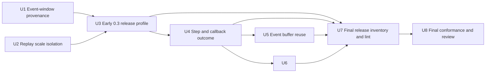
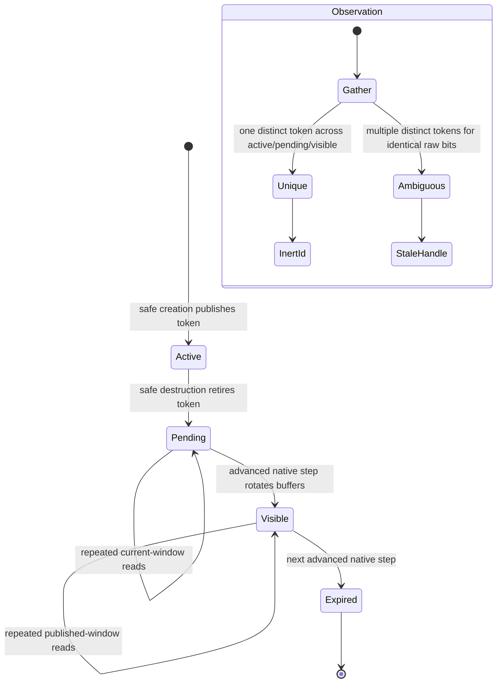
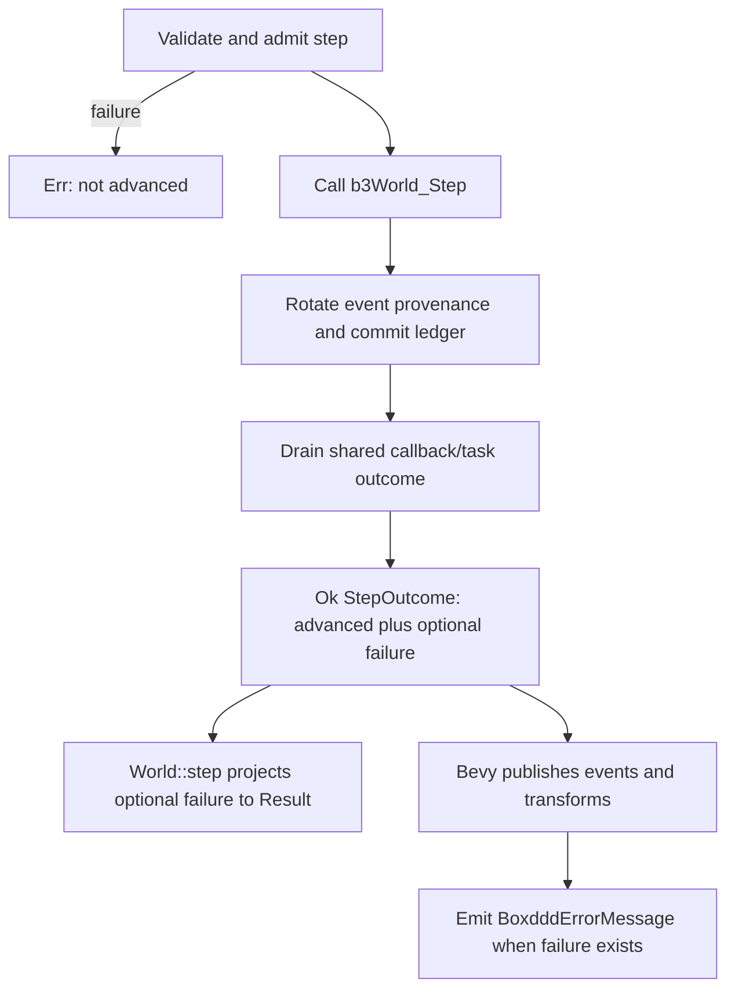
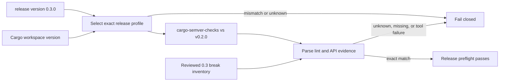

# Close Pre-Merge Runtime And Release Safety Gaps - Plan

## Goal Capsule

| Field | Decision |
|---|---|
| Objective | Close every validated pre-merge correctness gap in the `0.3.0` binding, then harden the adjacent callback, provider, allocation, and release contracts that can be proved with deterministic tests. |
| Authority | The checked-out branch and the pinned Box3D clone at `repo-ref/box3d` commit `781673be801569a94be7942848755fc0baad3653` define the implementation and upstream behavior. The `v0.2.0` tag defines the public semver baseline. |
| Execution profile | Breaking changes and deletion are authorized. Prefer one explicit invariant over compatibility shims, process-lifetime exclusions, hidden post-step state changes, or stale version-specific tooling. Rust source, tests, English documentation, CI, and local Conventional Commits are in scope. |
| Stop conditions | Stop only when the three validated P1 defects have focused regressions, all implementation units meet their definitions of done, and the full native, Bevy, provider, semver, formatting, lint, documentation, and package gates pass or name a verified external prerequisite. |
| Tail ownership | Implementation owns local commits on `refactor/deep-box3d-binding`. Pushing, opening a pull request, tagging, publishing, and changing the pinned upstream revision are excluded. |

---

## Product Contract

### Summary

The architecture refactor established Rust-owned definitions, owner-scoped handles, a transactional World ledger, centralized callback primitives, and a result-first API. The pre-merge review found three remaining release blockers: destruction-generated end events outlive their Rust provenance, `RecPlayer` leaks a process-global length scale into unrelated Worlds, and release preflight still audits the previous `0.2.0` release contract. The review also exposed two cross-layer consistency gaps: a native step can advance even though Bevy suppresses its events and transforms after a post-step callback error, and world callbacks plus worker tasks do not actually compete for the single invocation failure slot promised by the architecture documentation.

This plan fixes those defects at their state owners instead of adding call-site exceptions. Event provenance follows Box3D's double-buffer publication window. Replay length units become a scoped, lock-protected override rather than a player-lifetime lease. Step advancement becomes distinguishable from post-step reporting failure. Callback and task adapters share one invocation outcome. Provider smoke and release tooling exercise these contracts as runtime and release gates. A measured event-buffer optimization removes the known warm-path allocation without changing the zero-copy view API.

### Problem Frame

- Box3D appends contact and sensor end events to one buffer and exposes them only after the next step flips the buffer index. Rust currently clears all retired body, shape, and joint provenance at that same step boundary before event conversion occurs, so valid destruction-generated end events fail with `StaleHandle`.
- A resource destroyed after a step may still appear in the currently readable body/contact/joint events and in an end event that becomes readable on the next step. A single undifferentiated `retired` map cannot represent both windows, repeated getters, same-slot recreation, or native generation wrap.
- Upstream `b3RecPlayer_Create` changes Box3D's process-global length units and normally restores them only on player destruction. The current lifetime lease prevents setters and a second player, but it leaves unrelated Worlds running and constructing defaults under the replay scale.
- `World::step` commits native and ledger state before draining callback/task failures. Bevy treats any returned `Err` as if no step occurred and consequently suppresses events and transform synchronization for a simulation state that did advance.
- World/material callback failures and task-system failures use separate first-failure slots. Combining their final `Result` values after the native call does not provide the documented invocation-wide first-winner behavior.
- `*_events_into` promises reusable caller storage but maps through a newly allocated temporary `Vec` on every call. The zero-copy view APIs avoid this, yet the explicit reuse API does not meet its implied warm-path allocation contract.
- Provider smoke proves ABI presence and one runtime path, but does not reproduce the event-provenance and replay-scale defects, reinstantiate after teardown, or demonstrate recovery after a rejected operation.
- The workspace is `0.3.0` and its CI documentation names `v0.2.0` as the baseline, while the release workflow and audit script still select the `0.2.0`/`v0.1.0` profile and allowlist.

### Actors

- Core binding users who expect safe event snapshots and scoped views to preserve native observations without granting stale handles authority.
- Applications that run ordinary Worlds, replay recordings, or multiple players with different length scales in one process.
- Bevy applications that require events, transforms, and error messages to describe the same completed native step.
- Callback and task-system users who depend on deterministic first-failure capture, panic containment, and recovery on the next invocation.
- Browser/provider consumers who need the same required-supported behavior as native builds for event and replay surfaces.
- Maintainers who need a fail-closed `0.3.0` release audit against the published `0.2.0` API and narrow lint exemptions for generated code only.

### Requirements

**Event lifetime and handle authority**

- R1. Body, shape, joint, and contact provenance used by event conversion must model Box3D's current readable event window and next end-event write window independently; contact turnover must not clear resource event provenance.
- R2. Destroying a body, shape, or joint must retire its token before the native point of no return has exhausted fallible allocation, then keep the token observable for every native event window that can still reference it.
- R3. Repeated owned and scoped-view event reads within one native window must resolve to the same inert Rust IDs. Reading does not consume or extend the window.
- R4. Retired event IDs remain comparable and readable as event data, but all authoritative World operations reject them as `StaleHandle` without entering Box3D.
- R5. Publishing a replacement resource must not erase pending or visible provenance for an older resource with the same raw key. If active and retired candidates with identical raw bits carry different Rust tokens, including after forced `u16` generation wrap, observation fails closed rather than binding an old event to the replacement.
- R6. Contact observation has an active current epoch plus pending and visible event generations. Begin/hit events resolve or publish only in the current epoch; end events resolve or create an inert ID in the retired event generation and can never republish native authority. Event-window rotation occurs exactly once after an advanced native step, including when Rust later reports a callback or task failure.

**Replay length-unit isolation**

- R7. Before any replay native call, shared input validation parses the pinned little-endian 48-byte recording header and rejects a non-finite or non-positive `lengthScale`; valid player creation then captures both the ambient process scale and recording scale and restores ambient before returning on success or failure.
- R8. Every native `b3RecPlayer_*` call, including getters, restart, seek, sub-step, debug/query operations, and destruction, executes under the process-wide Box3D lock and one RAII replay-scale override that restores the call-entry ambient scale on every exit path.
- R9. Ordinary Worlds, raw length-unit setters, and multiple players with different recording scales may coexist and interleave safely. Remove the player-lifetime exclusion and its obsolete `LengthUnitsInUse` public error contract.
- R10. Replay creation order, interleaved operations, default construction, shape classification, failed creation, callback failure, and drop must never leave the process scale different from its value at the public call boundary.

**Step and callback outcome coherence**

- R11. Public `World::step_outcome(...) -> Result<StepOutcome>` must expose whether native simulation advanced separately from any callback/task failure reported after advancement, with public read-only and consuming error accessors. Existing `World::step` preserves its result-first convenience behavior by consuming and projecting that outcome.
- R12. Bevy must publish physics messages and synchronize transforms after every advanced native step, even when it also emits a `BoxdddErrorMessage` for a post-step callback/task failure. It skips publication only when validation or admission failed before native advancement.
- R13. World/material callbacks and installed worker tasks in one `World::step` invocation share one atomic first-failure state. The first successful capture remains stable; cleanup and task joins still run exactly once.
- R14. A failed callback/task invocation must not poison the next step. Registration snapshots are copied under short locks, no registry lock spans user code, and the World remains `!Send + !Sync`.

**Measured hot-path and provider hardening**

- R15. After caller and World scratch capacities are warmed, successful `body_events_into`, `sensor_events_into`, `contact_events_into`, and `joint_events_into` calls perform zero Rust heap allocations while preserving caller output transactionally on conversion failure.
- R16. The scoped zero-copy event views retain their current no-snapshot semantics; the allocation optimization must not merge or remove either public event representation.
- R17. A real-thread stress test must cover concurrent custom-filter, pre-solve, enqueue, worker, and finish paths, proving first-winner stability, exactly-once completion, and recovery on a later invocation.
- R18. Provider smoke must run the destruction/end-event and replay-scale coexistence contracts, drain the JavaScript error table even when World destruction reports a callback error, reject malformed or incomplete operations without trapping, instantiate and tear down the provider at least twice in one host process, and complete a valid operation after each negative path.
- R19. Required provider capabilities and ABI literals remain independent conformance evidence. Do not weaken literal golden checks or claim support for intentionally unsupported debug callback surfaces.

**Release and quality gates**

- R20. Release preflight for workspace version `0.3.0` must run `cargo-semver-checks` against `v0.2.0` with the reviewed minor-release break inventory. Unknown versions, unknown breaks, missing expected breaks, and tool failures without parseable break blocks all fail closed.
- R21. One tested release-profile definition must bind workspace version, baseline ref, release type, diagnostics, and allowlist. Delete stale `EXPECTED_0_2_BREAKS`, `v0.1.0` defaults, and misleading `known 0.2` output from the active tool.
- R22. Workflow conditions, CLI behavior, CI documentation, migration guidance, and changelog must agree on the `0.3.0` contract. The final allowlist is generated only after all public API deletion is complete and is then manually reviewed.
- R23. Strict clippy must be clean for handwritten workspace code. Any exemption needed by bindgen output is scoped to the generated binding module or generation template and must not suppress the same lint in handwritten code.
- R24. All new behavioral claims require focused regressions plus the full existing matrix; dead lease code, obsolete tests, stale documentation, and superseded helpers are deleted rather than retained as compatibility scaffolding.

### Acceptance Examples

- AE1. Given two touching shapes and one is destroyed, when the next step publishes the contact end event, then owned and scoped-view reads both return the destroyed shape's original inert ID on repeated calls, while `World` operations on that ID return `StaleHandle`.
- AE2. Given a sensor overlap and either the sensor body or visitor body is destroyed, when the next step publishes the sensor end event, then both event sides resolve correctly and remain readable until the following event-window rotation.
- AE3. Given a resource is destroyed after a step whose current events reference it and its native slot is recreated, when current and next-window events are read, then each unambiguous event resolves to its original Rust token; forced raw-bit ambiguity returns `StaleHandle` and never authorizes or aliases the replacement.
- AE4. Given a scale-100 recording player exists while the ambient scale is 1, when a normal World constructs defaults and classifies a short capsule, then it observes scale 1 and the capsule remains a capsule rather than being classified under replay scale.
- AE5. Given two players recorded at different scales, when their operations and an ambient setter are interleaved, then each player runs at its recording scale and every public call restores the scale observed at entry.
- AE6. Given a pre-solve callback or worker task wins the shared failure race after Box3D has advanced, when the step returns through the core and Bevy APIs, then the error is reported once while events and transforms for that completed step are still published.
- AE7. Given warmed caller buffers, when each `*_events_into` API is called repeatedly, then an allocation counter observes zero allocations and injected conversion failure leaves the prior caller contents unchanged.
- AE8. Given provider smoke has completed one valid run, when a malformed replay or missing/rejected operation is exercised and the module is torn down, then a fresh instance completes the event and replay metrics without stale callback, memory, or length-scale state.
- AE9. Given release input `0.3.0`, when the semver audit runs, then it invokes the `v0.2.0` minor baseline and accepts only the reviewed `0.3.0` inventory; any other release version or inventory drift fails with a precise diagnostic.

### Scope Boundaries

- Do not update Box3D beyond pinned commit `781673be801569a94be7942848755fc0baad3653` or change provider ABI revision solely to implement Rust-side lifetime fixes.
- Do not make `World`, `RecPlayer`, callback owners, or native state `Send` or `Sync`; serialization through the existing Box3D lock is intentional.
- Do not claim that unsafe raw structural mutations maintain the safe ledger. That escape hatch remains caller-owned and explicitly unsafe.
- Do not invent success/failure signals for upstream `void` replay operations. The wrapper guarantees scale restoration and state safety, not errors that Box3D does not expose.
- Do not weaken the independent literal provider ABI golden test, capability inventory, or raw layout tests to make generated values self-consistent.
- Do not replace callback registry locking or add a benchmark framework without a measured regression. The proven allocation in `*_events_into` is in scope; speculative callback lock tuning is not.
- Do not preserve `LengthUnitsInUse`, the lifetime lease, stale semver profiles, or compatibility aliases after their invariants are superseded.
- Do not push, open a pull request, tag, publish, or bind `main` to a worktree.

---

## Planning Contract

### Key Technical Decisions

- KTD1. Execute all validated P1 fixes before adjacent hardening, but finish the entire dependency-ordered program in this branch. `(session-settled: user-approved - chosen over stopping after only the three blockers because the user explicitly approved all reviewed improvements.)`
- KTD2. Breaking API changes and deletion are preferred when the previous contract encodes an invalid invariant. `(session-settled: user-directed - chosen over deprecation shims because the user explicitly authorized fearless refactoring and removal.)`
- KTD3. Replace `ResourceRegistry`'s single retired map with active, pending, and visible event generations. Pending entries resolve both the still-readable current snapshot and the next end-event window; after an advanced step, old visible entries expire and pending entries become visible. Contacts use the same retired-window idea but retain a separate active epoch and event-kind-specific resolution so an end event cannot recreate authority.
- KTD4. Preserve multiple candidates or an explicit ambiguity marker for a raw key inside each event generation. Observation gathers all applicable candidates and succeeds only when they identify one resource token; authorization consults active membership only. This is chosen over active-first lookup, arbitrary TTLs, getter-driven consumption, or allowing publication to erase retirement.
- KTD5. Replace the player-lifetime `LengthUnitsLease` with a lock-scoped `LengthUnitsOverride`. Player creation records the scale obtained from replay metadata and immediately restores ambient state; every later player call uses one helper that sets recording scale and restores the entry scale in `Drop`, including after upstream destroy performs its own restoration.
- KTD6. Allow multiple live players and ambient raw setters. `(session-settled: user-approved - chosen as the strongest isolation contract consistent with the requested breaking refactor, instead of keeping exclusions that only mask global-state leakage.)`
- KTD7. Add public `World::step_outcome(...) -> Result<StepOutcome>`, whose outer `Err` means native simulation did not advance and whose successful value may carry a post-step callback/task failure through read-only and consuming accessors. Keep `World::step` as a consuming projection for direct users; Bevy calls the public richer operation so state publication follows advancement rather than error presence.
- KTD8. Install one invocation-scoped `SharedCallbackState` into both World callbacks and the task context before native step. Worker adapters clone the same state, first capture wins atomically, and an RAII invocation guard detaches it only after Box3D's blocking task completion and outcome drain.
- KTD9. Retain current registration snapshot locking until a metric demonstrates contention. Add real-thread correctness stress now; do not mix speculative lock-free registry work into a correctness release gate.
- KTD10. Give the World reusable typed event scratch buffers and transactionally swap successful conversions into caller-owned buffers. A dedicated allocation-count test binary establishes the warm-path zero-allocation contract without a third-party benchmark dependency.
- KTD11. Extend the existing `xtask provider-smoke` route and WASM fixture instead of adding a second runtime harness. The Node host owns repeated instantiation, teardown, negative-path recovery, and exported metric assertions.
- KTD12. Replace release-specific conditionals with one fail-closed `0.3.0` profile selected from the workspace/release input as soon as the three release blockers are fixed. Re-run and finalize the exact lint-plus-API allowlist after every later API-changing unit; generic ignores are rejected.
- KTD13. Scope generated-code lint allowances at the generated include boundary or generator output. Workspace-level `allow` attributes and lowering handwritten lint severity are rejected.
- KTD14. Source edits and Cargo commands are serialized with `CARGO_BUILD_JOBS=1`. Independent read-only review may be parallel, but no implementation agent owns overlapping files and the primary agent owns commits and final verification.

### Priority Order

1. **P0 - Event correctness:** repair destruction-event provenance and raw-key ambiguity before any downstream event consumer or allocation optimization changes.
2. **P0 - Global-state isolation:** replace the replay lifetime lease with scoped restoration and prove ordinary World coexistence.
3. **P0 - Release truth:** make the `0.3.0`/`v0.2.0` profile and workflow selection executable immediately after the blocker fixes; finalize its break inventory after later API changes.
4. **P1 - Step outcome integrity:** align callback/task first-failure state and Bevy publication with the native point of no return.
5. **P1 - Runtime parity:** reproduce the corrected event and replay behavior in provider smoke, including teardown and recovery.
6. **P2 - Measured hot path:** eliminate the verified temporary allocation while preserving transactional outputs and scoped views.
7. **P2 - Release inventory and merge quality:** re-audit the final public API, tighten generated lint scope, update English documentation, run the complete matrix, and perform a fresh diff review.

### Dependency Graph



Source work and Cargo verification remain serial even where dependency arrows permit conceptual parallelism.

### High-Level Technical Design

#### Event provenance windows



`pending` is also the overlay for events that were already readable when destruction occurred after a step. Rotation is owned by the step finalizer, never by a getter. Publishing a new active token does not mutate either retired generation. A collision inside one generation becomes explicit ambiguity rather than overwriting an older token. Contact IDs additionally retain their independent epoch because contact authority changes on mutations that do not rotate Box3D's event buffers: begin/hit resolution uses only the current active epoch, while end resolution yields an ID whose retired epoch makes authorization fail before FFI.

#### Replay scale call protocol

```mermaid
sequenceDiagram
    participant Caller
    participant Player as RecPlayer
    participant Lock as Box3D global lock
    participant Guard as LengthUnitsOverride
    participant C as Box3D replay API

    Caller->>Player: operation(...)
    Player->>Lock: acquire
    Lock->>Guard: capture ambient; set recording scale
    Guard->>C: b3RecPlayer_* call
    C-->>Guard: value / callback outcome / destroy side effect
    Guard->>Guard: restore captured ambient in Drop
    Guard-->>Lock: release
    Lock-->>Player: translate result
    Player-->>Caller: return with ambient unchanged
```

Creation is a special case of the same rule: upstream creates the player and changes the scale, Rust reads the recording scale while locked, records it in the owner, and restores the pre-create ambient value before publication. Failure cleanup runs before the lock is released.

#### Advanced step reporting



The richer outcome does not reinterpret an upstream error as success. It records the already existing fact that the irreversible native step and Rust finalizer completed before callback/task reporting. Consumers can therefore keep their projections coherent.

#### Release gate



### Assumptions

- Box3D's event getter contract remains tied to the pinned source's two end-event buffers; future upstream changes must update the conformance tests and this ledger state machine together.
- Safe Rust is the sole structural mutation authority during these tests. Unsafe raw structural mutation remains outside ledger guarantees.
- Box3D joins every non-null task handle before `b3World_Step` returns, as established by the pinned solver implementation; the shared invocation state therefore need not outlive the step finalizer.
- `RecPlayer` metadata exposes the recording length scale after successful creation. If a getter also rebuilds native replay state, wrapping every entry point still preserves correctness.
- Nextest executes the dedicated allocation regression in an isolated process; the counter is enabled only around the warmed call under test.
- Emscripten, Node, `wasm-bindgen`, `actionlint`, and `cargo-semver-checks` are locally available. A missing tool is reported with its exact command and prerequisite, not treated as a pass.
- Local Conventional Commits are authorized. No push, tag, package publication, or PR creation is implied.

### System-Wide Impact

- **Core ledger:** resource registries gain explicit event generations and ambiguity handling; contact epoch and event-window rotation become separate operations.
- **Recording API:** the lifetime lease and `LengthUnitsInUse` disappear; `RecPlayer` stores recording-scale metadata and routes every native call through one scoped helper.
- **Step API:** `StepOutcome` and `World::step_outcome` are public because Bevy is a separate workspace crate; existing direct callers retain result-first behavior through `World::step`.
- **Callbacks and tasks:** installed task state participates in the World's invocation failure slot without changing Box3D's task join or exactly-once contracts.
- **Events:** caller-buffer APIs reuse World scratch storage; owned constructors and zero-copy views keep their roles.
- **Bevy:** message and transform publication key off native advancement, and destruction-end messages retain the surviving side's entity mapping without inventing tombstones for removed entities.
- **Provider:** smoke exports gain event/replay metrics and the Node host exercises repeated lifecycle and recovery.
- **Release tooling:** CI, the audit script, tests, and docs converge on one `0.3.0` profile against `v0.2.0`.

### Risks And Mitigations

| Risk | Consequence | Mitigation |
|---|---|---|
| Pending and visible provenance overlap with a recreated raw key. | An old event could silently identify a new live resource. | Preserve distinct token candidates, return `StaleHandle` on ambiguity, and force generation-wrap cases in registry tests. |
| Retirement storage grows without a consumption boundary. | Long-running mutation-heavy Worlds retain unbounded metadata. | Rotate only on advanced steps and prove expiry after the second boundary; getters never extend lifetime. |
| A post-step destroy must serve both current and next event windows. | One of the event snapshots loses provenance. | Let pending entries participate in current observation before promotion and cover both reads in one regression. |
| Upstream player destruction restores its own saved scale. | Rust's ambient scale could be overwritten during `Drop`. | Keep the outer scoped override alive through destroy and restore the call-entry value after upstream returns. |
| Multiple players interleave operations. | One recording could execute at another recording's scale. | Serialize the set/call/restore sequence under the global Box3D lock and test alternating scales. |
| A callback failure occurs after native advancement. | Consumers may publish an error but stale state. | Commit ledger/event rotation first, return a structured advanced outcome, then have Bevy publish state before emitting the error. |
| Sharing failure state changes task teardown ordering. | Late worker access could use detached state. | Install via RAII, rely on Box3D's blocking finish contract, assert exactly-once joins, and detach only after native return. |
| Reusable scratch aliases an active scoped event view. | RefCell panic or invalid borrow could replace an FFI error. | Keep scratch borrowing inside owned conversion APIs, do not call through scoped views, and test nested callback guards and conversion failure. |
| Allocation counting is noisy. | A false regression gate blocks unrelated changes. | Use a single-test integration binary, warm all capacities, enable counting only around the target call, and assert both allocation count and output correctness. |
| Provider smoke becomes nondeterministic or too broad. | CI becomes flaky and obscures the core regressions. | Export integer diagnostics, use deterministic tiny worlds/recordings, keep one existing harness, and report the exact failed metric. |
| The semver allowlist is captured before API deletion ends. | Release CI accepts an incomplete or stale inventory. | Make U7 depend on every later API-changing unit, regenerate there, and unit-test unknown/missing break behavior. |
| Generated lint allowances hide handwritten warnings. | Strict clippy loses review value. | Apply attributes only to generated modules/templates and run strict clippy across the workspace after generation checks. |

### Sources And Research

- `docs/plans/2026-07-27-001-refactor-deepen-box3d-rust-binding-plan.md`: the implemented architecture contract and its verification vocabulary.
- The 2026-07-28 clean-context pre-merge review: three validated P1 findings plus residual risk and test-gap inventory.
- `repo-ref/box3d/src/physics_world.c`, `shape.c`, `contact.c`, `sensor.c`, and `recording_replay.c`: event-buffer rotation, destruction-generated events, and replay global-scale behavior.
- `boxddd/src/world/ledger.rs`, `world/runtime.rs`, and `events.rs`: current retired provenance, step finalization, event resolution, and transactional mapping.
- `boxddd/src/core/length_units_lease.rs`, `recording.rs`, `raw.rs`, `body.rs`, `shapes.rs`, and `world.rs`: current player lease and scale-sensitive defaults.
- `boxddd/src/core/callback_state.rs`, `core/task_system.rs`, `callbacks.rs`, and `world/runtime.rs`: callback snapshots, independent failure slots, task joins, and result combination.
- `bevy_boxddd/src/systems.rs`, `plugin.rs`, and `bevy_boxddd/tests/messages.rs`: Bevy step failure, publication ordering, cleanup, and entity mapping.
- `examples-wasm/provider-smoke`, `xtask/src/main.rs`, and `docs/upstream-parity/box3d-capability-inventory.json`: the existing provider runtime harness and required capabilities.
- `.github/workflows/release-preflight.yml`, `tools/semver_audit.py`, `tools/tests`, `docs/development/ci.md`, and workspace manifests: current release-version inconsistency and test patterns.

---

## Implementation Units

### U1. Event-Window Provenance And Fail-Closed Observation

**Intent:** Make safe event conversion follow Box3D's native publication windows without restoring authority to destroyed resources.

**Requirements:** R1-R6, R24

**Dependencies:** None.

**Primary files:**

- `boxddd/src/world/ledger.rs`
- `boxddd/src/world/runtime.rs`
- `boxddd/src/events.rs`
- mutation finalizers under `boxddd/src/body.rs`, `shapes.rs`, `joints/`, and `world/`
- `boxddd/tests/events_and_sensors.rs`
- focused ledger module tests and `boxddd/tests/world_destroy_and_recycle.rs`

**Approach:**

- Write public regressions first for shape/body destruction, contact and sensor end events, repeated owned/view reads, expiry, and stale authority. Confirm the current branch fails for the expected provenance reason.
- Replace `ResourceRegistry<K>::retired` with bounded pending and visible event generations. Preserve old candidates when `publish` sees the same raw key, and make `retire` reserve all required state before native destruction.
- Separate `finish_contact_turnover` from an event-window finalizer. Contact mutations reserve retirement capacity, move observed current-epoch contacts into pending event provenance, and advance only the active epoch; every completed native step rotates body/shape/joint/contact event provenance exactly once before callback/task errors are returned.
- Resolve body/shape/joint observations by collecting distinct tokens from active, pending, and visible entries. Return the canonical stale/ambiguous handle error unless the candidate set is unique. Keep authorization active-only.
- Split contact conversion by event kind. Begin/hit events resolve or publish in the active current epoch; end events resolve a pending/visible token and its retired epoch, allocating an inert retired token when the contact was never previously observed. An end-event lookup never inserts into the active registry.
- Add injectable registry tests for raw-key reuse and forced `u16` generation wrap without requiring 65,536 native allocations. Cover two adjacent retirement windows and multiple retirements of the same raw key.
- Extend Bevy-facing coverage in U6; keep this unit focused on the core owner and event contracts.

**Invariants:**

- No event getter consumes provenance.
- No contact-only mutation rotates resource event generations.
- No active publication overwrites retired identity.
- No contact end event creates a token in the active epoch; its ID is stale before any native validity check.
- A returned inert ID carries the original resource token or conversion fails closed; it never carries a replacement token.
- Retirement memory is bounded by two native event windows and active pending mutations.

**Test scenarios:**

- Destroy a touching shape, step, and read contact end events repeatedly through owned and scoped APIs.
- Observe a contact before destruction and leave another unobserved; assert both end-event contact IDs resolve inertly and reject `contact_data` before FFI.
- Destroy sensor and visitor bodies in separate cases and resolve both event sides.
- Destroy immediately after a step, read the current snapshot, then step and read its destruction end event.
- Recreate the same slot before reading and force equal raw generation bits; assert ambiguity is stale and replacement authority remains intact.
- Rotate two steps without a new retirement and assert expired provenance no longer resolves.
- Return a callback/task error after native step and assert rotation still committed.

**Verification:**

- `CARGO_BUILD_JOBS=1 cargo nextest run -p boxddd --lib world::ledger`
- `CARGO_BUILD_JOBS=1 cargo nextest run -p boxddd --test events_and_sensors`
- `CARGO_BUILD_JOBS=1 cargo nextest run -p boxddd --test world_destroy_and_recycle`

**Definition of done:** Destruction-generated and post-step events resolve for exactly the native readable windows, stale IDs remain inert, raw-key ambiguity fails closed, and all retirement paths are bounded and transactionally staged.

### U2. Scoped RecPlayer Length-Unit Isolation

**Intent:** Permit Worlds and multiple replay players to coexist without leaking process-global Box3D scale.

**Requirements:** R7-R10, R24

**Dependencies:** None.

**Primary files:**

- `boxddd/src/core/length_units_lease.rs` or its replacement module
- `boxddd/src/core/mod.rs`
- `boxddd/src/recording.rs`
- `boxddd/src/raw.rs`
- `boxddd/src/error.rs`
- `boxddd/tests/recording.rs`
- `docs/migrating-0.2-to-0.3.md`

**Approach:**

- Add regressions that reproduce scale-100 replay changing scale-1 defaults and capsule classification, plus two-player interleaving and failure/drop restoration.
- Extend the shared replay-input validator to parse the pinned version's fixed little-endian 48-byte header before `b3RecPlayer_Create` or `b3ValidateReplay`. Validate the header length and `lengthScale` field as finite and strictly positive without constructing a native player.
- Replace lifetime lease bookkeeping with a private RAII override that may only be created while the process-wide Box3D lock is held. Capture the current scale, set the requested scale, and restore the captured value in `Drop`.
- During player creation, capture ambient scale before C, retrieve/store the replay scale after successful creation, and restore ambient before publishing the Rust owner. Ensure every cleanup branch restores before unlock.
- Route every player FFI entry point and `Drop` through one helper that holds the global lock and override for the complete native operation. Let the outer guard correct upstream destroy's own `previousLengthScale` restoration.
- Delete the exclusive lease registry, `LengthUnitsInUse`, setter blocking, and tests/docs that describe lifetime exclusion. Keep invalid scale validation and callback admission.

**Invariants:**

- Public call entry and exit observe the same ambient length scale.
- Native replay code observes the player's recording scale for its whole operation.
- A player owns no process-global setting between calls.
- Restoration is non-panicking and occurs before releasing the Box3D lock.

**Test scenarios:**

- Create and retain a scale-100 player while a normal scale-1 World builds defaults and creates/classifies a short capsule.
- Interleave restart, seek, step, query/debug, and getters for two players with different scales.
- Change ambient scale between player calls and assert each exit restores the new ambient value.
- Feed malformed recording bytes and inject callback failure; assert ambient restoration and a subsequent valid operation.
- Starting from valid recorded bytes, replace the header scale with zero, a negative value, NaN, and positive infinity; assert typed rejection before native entry and unchanged ambient state.
- Drop players in both creation orders and verify restoration after each destructor.

**Verification:**

- `CARGO_BUILD_JOBS=1 cargo nextest run -p boxddd --test recording`
- `CARGO_BUILD_JOBS=1 cargo nextest run -p boxddd --test result_api`

**Definition of done:** `RecPlayer` has call-scoped scale ownership only, multiple players and ordinary Worlds coexist, every exit restores ambient state, and no lease-era API or implementation remains.

### U3. Activate The 0.3 Release Profile

**Intent:** Stop release preflight from skipping or misbaselining the branch before adjacent hardening begins.

**Requirements:** R20-R22, R24

**Dependencies:** U1-U2.

**Primary files:**

- `tools/semver_audit.py`
- `tools/tests/test_semver_audit.py`
- `.github/workflows/release-preflight.yml`
- `Cargo.toml` and crate manifests only where version consistency is read
- `docs/development/ci.md`

**Approach:**

- Write Python tests first for release-profile selection, workspace-version agreement, command construction, exact known-break matching, unknown/missing breaks, and unparseable tool failure.
- Replace the stale `0.2.0` condition, `v0.1.0` default, and `EXPECTED_0_2_BREAKS` vocabulary with one fail-closed `0.3.0` profile using `v0.2.0` and minor release type. Unknown release versions fail before invoking Cargo.
- Run the real audit after U2's public deletion and review the exact lint-plus-API evidence needed for the branch at this point. Update the workflow to select the same profile and make a consistency test read both workspace metadata and workflow/profile data.
- Update CI documentation so its executable command, workflow behavior, and diagnostics agree. U7 owns the mandatory final rerun after later units and any resulting inventory adjustment.

**Invariants:**

- Release input `0.3.0` cannot skip the semver step or select `v0.1.0`.
- An unknown workspace/release version, unknown break, missing break, or non-semver tool failure is fatal.
- Every accepted break includes both its lint class and an identifying API evidence needle.
- The early inventory is reviewed evidence, not a wildcard; U7 must prove it remains complete after later work.

**Test scenarios:**

- Select `0.3.0` and assert `v0.2.0`, minor release type, and both published workspace crates.
- Supply unknown version, mismatched workspace version, unknown break, missing expected break, and tool failure without parseable blocks.
- Mutate workflow/profile fixture text and assert the consistency test catches condition, baseline, or release-type drift.
- Run the real audit and match every observed break exactly.

**Verification:**

- `python3 -m unittest discover -s tools/tests`
- `python3 tools/semver_audit.py --release-version 0.3.0`
- `actionlint .github/workflows/release-preflight.yml`

**Definition of done:** The third validated P1 blocker is closed: release preflight actively audits `0.3.0` against `v0.2.0`, fails closed on drift, and has executable unit and workflow evidence before adjacent hardening proceeds.

### U4. Advanced Step Outcome And Invocation-Wide Failure State

**Intent:** Make irreversible native advancement and callback/task reporting one coherent, inspectable protocol.

**Requirements:** R6, R11-R14, R17, R24

**Dependencies:** U1, U3.

**Primary files:**

- `boxddd/src/world/runtime.rs`
- `boxddd/src/world.rs`
- `boxddd/src/core/callback_state.rs`
- `boxddd/src/core/task_system.rs`
- `boxddd/src/callbacks.rs`
- `boxddd/src/error.rs`, `boxddd/src/lib.rs`, and `boxddd/src/prelude.rs` for the public outcome contract
- `boxddd/tests/task_system.rs`
- `boxddd/tests/world_callbacks.rs`
- focused step-result tests

**Approach:**

- Characterize validation/admission failures, successful steps, world callback failures, task failures, and racing failures before changing the public result shape.
- Introduce public `StepOutcome` and `World::step_outcome`. Construction proves native advancement; the value owns an optional post-step failure and exposes read-only state plus a consuming projection. `World::step` consumes that value to retain its current `Result<()>` behavior, while downstream crates can react to advancement before consuming the failure.
- Move event-window and ledger finalization into an infallible post-native section that runs before draining the shared outcome.
- Create one invocation failure state at step admission. Install it into World/material registrations and the task context with RAII; task workers clone it without borrowing `World`; detach only after native step/task join completes.
- Preserve atomic first-winner semantics across all adapter families, exactly-once task accounting, callback-depth guards, and recovery. Do not hold callback registry or task installation locks across user code.
- Add Barrier-driven real-thread races and deterministic single-family failure tests. Verify later steps start from a fresh failure state.

**Invariants:**

- The richer step operation's outer `Err` means Box3D was not called; `World::step` may project an advanced outcome's post-step failure to `Err` after Rust finalizers commit.
- One atomic slot decides the reported callback/task failure for an invocation.
- All task handles finish before invocation state detaches.
- Post-step failure does not roll back, suppress, or mislabel committed simulation state.

**Test scenarios:**

- Invalid time step/substep and callback reentry produce a non-advanced error.
- Pre-solve failure after native entry returns an advanced outcome and stale contacts/event rotation are committed.
- Task and material callbacks race behind a Barrier; exactly one stable failure wins and all work finishes once.
- A failing step followed by a clean step reports no stale failure.
- `World::step` continues returning the winning failure for direct callers.

**Verification:**

- `CARGO_BUILD_JOBS=1 cargo nextest run -p boxddd --test task_system`
- `CARGO_BUILD_JOBS=1 cargo nextest run -p boxddd --test world_callbacks`
- `CARGO_BUILD_JOBS=1 cargo nextest run -p boxddd --lib callback_state`

**Definition of done:** Core callers can distinguish non-advancement from post-step failure, every step finalizer runs at the correct point of no return, and all callback/task families share one tested first-failure invocation state.

### U5. Transactional Reusable Event Buffers

**Intent:** Make the explicit caller-buffer APIs allocation-free after warmup without weakening failure atomicity or zero-copy views.

**Requirements:** R15-R16, R24

**Dependencies:** U1, U4.

**Primary files:**

- `boxddd/src/core/ffi_vec.rs`
- `boxddd/src/events.rs`
- World-owned state modules for typed scratch storage
- a dedicated allocation regression under `boxddd/tests/`
- event conversion fault-injection tests

**Approach:**

- Add a single-test integration binary with a guarded counting allocator. Warm native event production, caller capacity, and each typed World scratch buffer before enabling the counter.
- Replace per-call temporary allocation with typed World-owned scratch. Clear and fill scratch while preserving the caller buffer; on success swap buffers so the old caller allocation becomes next-call scratch, and on failure clear scratch while leaving caller contents unchanged.
- Keep owned snapshot constructors free to allocate and keep scoped event views independent of scratch. Reject nested scratch borrowing with a typed/admission path rather than an incidental panic if current public call patterns can reach it.
- Prove capacity remains bounded/reused across variable event counts and all four event families.

**Invariants:**

- Successful warmed `*_events_into` performs zero Rust heap allocations.
- Failed conversion does not change caller length, elements, or allocation ownership.
- Scratch does not outlive World and never aliases native event memory.
- Scoped views do not borrow or mutate scratch.

**Test scenarios:**

- Warm and count each of the four `*_events_into` methods with non-empty events.
- Grow once, repeat smaller/larger-within-capacity conversions, and assert zero allocations.
- Inject stale/ambiguous conversion after caller population and assert exact caller preservation.
- Exercise owned snapshots and scoped views before and after reuse to detect accidental coupling.

**Verification:**

- `CARGO_BUILD_JOBS=1 cargo nextest run -p boxddd --test event_allocations`
- `CARGO_BUILD_JOBS=1 cargo nextest run -p boxddd --test events_and_sensors`

**Definition of done:** Caller-buffer event APIs honor a measured zero-allocation warm path and transactional failure contract while owned and scoped APIs retain their existing semantics.

### U6. Bevy And Provider Runtime Parity

**Intent:** Carry the corrected core contracts through both downstream execution paths and prove lifecycle recovery in a real provider host.

**Requirements:** R12, R17-R19, R24

**Dependencies:** U1, U2, U4.

**Primary files:**

- `bevy_boxddd/src/systems.rs`
- `bevy_boxddd/src/plugin.rs`
- `bevy_boxddd/src/errors.rs` and public resources if required
- `bevy_boxddd/tests/messages.rs`
- `examples-wasm/provider-smoke/src/lib.rs`
- `xtask/src/main.rs`
- provider fixture or host code under `boxddd-sys/provider/` as required
- `docs/platforms/wasm-callbacks.md` and provider documentation

**Approach:**

- Change Bevy step orchestration to consume the advanced outcome. Always publish Box3D events and synchronize transforms for an advanced step, then emit its callback/task error. Retain skip behavior for pre-native validation/admission failures.
- Add Bevy contact/sensor destruction-message tests. A removed entity may remain `None`; the surviving side must retain its entity mapping and no `ReadEvents` error may be emitted.
- Add deterministic provider smoke exports for destruction-generated end-event conversion and replay/ambient-scale coexistence. Keep diagnostics as exact integer metrics.
- Fix and exercise World-destruction cleanup so provider callback failures are drained from the JavaScript error table before the token/context is retired; a later World must not observe the stale error.
- Extend the Node host to execute negative then valid operations, dispose all exported/native state, instantiate the same module again in the same process, and repeat the valid metrics. Validate the required import/export set before execution and keep intentionally unsupported capabilities unchanged.
- Exercise callback/task recovery on native where provider capabilities intentionally exclude those callbacks; do not fabricate parity.

**Invariants:**

- Bevy's messages, transforms, and errors describe the same native step.
- Removed entity mappings are not resurrected merely to decorate end events.
- Provider teardown leaves no callback token, memory view, player, World, or global scale that affects the next instance.
- World-destruction callback errors are reported once and removed from the provider error table even when teardown itself returns an error.
- Negative paths return diagnostics instead of trapping and do not weaken ABI/capability checks.

**Test scenarios:**

- Post-step callback failure emits one error plus the completed step's events and transforms.
- Pre-native failure emits an error and no physics publication.
- Body/shape destruction yields contact and sensor end messages with surviving entity mapping.
- Provider malformed replay/rejected operation is followed by valid event/replay metrics.
- A provider World destruction callback records an error; teardown drains it, and the next World completes without inheriting that error.
- Two provider instances in one Node process produce identical valid metrics after complete teardown.

**Verification:**

- `CARGO_BUILD_JOBS=1 cargo nextest run -p bevy_boxddd --test messages`
- `CARGO_BUILD_JOBS=1 cargo nextest run -p bevy_boxddd`
- `CARGO_BUILD_JOBS=1 cargo run -p xtask -- provider-smoke`

**Definition of done:** Bevy publishes every advanced step coherently, provider mode reproduces both corrected P1 runtime contracts, and negative/teardown/reinstantiation paths recover without stale global or callback state.

### U7. Final 0.3 Release Inventory And Lint Contract

**Intent:** Reconcile the active release profile with the final public API, then scope strict linting to trustworthy source boundaries.

**Requirements:** R20-R24

**Dependencies:** U3-U6.

**Primary files:**

- `tools/semver_audit.py`
- `tools/tests/test_semver_audit.py`
- `.github/workflows/release-preflight.yml`
- `Cargo.toml` and crate manifests only if consistency checks require metadata
- `boxddd-sys/src/ffi.rs` or binding templates/generator output
- `docs/development/ci.md`
- `docs/migrating-0.2-to-0.3.md`
- `CHANGELOG.md`

**Approach:**

- Re-run U3's Python profile and workflow consistency tests from the final source tree; do not create a second profile definition or duplicate version constants.
- Run `cargo-semver-checks` after U4-U6 settle. Compare every final break block to U3's inventory, review each addition/removal against the migration contract, and update the exact lint-plus-API allowlist only where the public diff proves it necessary. Never add wildcard or lint-only generic suppression.
- Confirm the workflow still selects `0.3.0`, `v0.2.0`, and minor release type through the tested profile. Any drift is fixed at the single U3-owned source rather than patched independently in CI.
- Narrow generated binding lint allowances at the include/generation boundary, then run strict workspace clippy to expose handwritten warnings. Fix handwritten warnings rather than suppressing them.
- Align CI docs, migration guide, and changelog with multiple replay players, removed lease error, step outcome behavior, event windows, and the final release gate.

**Invariants:**

- The single U3 release profile remains the only version, baseline, release-type, and break-inventory authority.
- CI cannot silently skip semver auditing for the current workspace version.
- Known-break matching remains exact and unknown/missing evidence fails.
- Generated lint policy cannot mask handwritten code.

**Test scenarios:**

- Re-run selection and negative-path tests for unknown versions, inventory drift, and non-semver tool failure.
- Run the real final audit and compare each accepted block to the reviewed migration inventory.
- Re-run workflow consistency after all documentation and profile edits.
- Run strict clippy and prove generated allowances do not cover a deliberately linting handwritten fixture/module where such a focused test is practical.

**Verification:**

- `python3 -m unittest discover -s tools/tests`
- `python3 tools/semver_audit.py --release-version 0.3.0`
- `actionlint .github/workflows/release-preflight.yml`
- `CARGO_BUILD_JOBS=1 cargo clippy --workspace --all-targets --all-features -- -D warnings`

**Definition of done:** The early `0.3.0` profile still exactly describes the final API against `v0.2.0`, every inventory change is reviewed, docs agree, and strict clippy distinguishes generated from handwritten code.

### U8. Final Conformance, Simplification, And Merge Review

**Intent:** Remove obsolete implementation paths, validate the complete matrix, and independently review the final diff before declaring the goal complete.

**Requirements:** R19, R22-R24

**Dependencies:** U1-U7.

**Primary files:**

- touched Rust, Python, workflow, provider, and documentation files
- `docs/development/ffi-lifetime-audit.md`
- `docs/api-coverage.md` where behavioral claims changed
- this plan's `Execution Outcome`

**Approach:**

- Run a behavior-preserving simplification pass over the changed code, removing duplicate helpers, lease-era state, superseded event retirement methods, unused imports, and stale documentation.
- Verify generated/vendor status and public coverage without changing the pinned upstream revision or accepting unexplained generated diffs.
- Run focused gates first, then the full all-feature workspace matrix serially. Record exact unavailable external prerequisites; do not convert them into passing claims.
- Dispatch a fresh-context, read-only pre-merge review across correctness, API/contract, reliability/concurrency, performance, and adversarial lenses. Fix all validated P0/P1 findings and add regressions; rerun affected and full gates.
- Make reviewable Conventional Commits at unit boundaries using exact staging. Append an execution outcome with commits, verification evidence, intentional deferrals, and any external blocker.

**Invariants:**

- No cleanup operation reverts user-owned work or unrelated files.
- No final claim relies only on an old plan outcome or prior test count.
- P0/P1 review findings are fixed before completion; lower-severity deferrals state measurable rationale.
- The working tree contains only intentional changes after each precise commit.

**Verification:**

- `cargo fmt --all --check`
- `git diff --check`
- `CARGO_BUILD_JOBS=1 cargo nextest run --workspace`
- `CARGO_BUILD_JOBS=1 cargo nextest run --workspace --all-features`
- `CARGO_BUILD_JOBS=1 cargo test --workspace --doc --all-features`
- `CARGO_BUILD_JOBS=1 cargo check --workspace --all-targets --all-features`
- `CARGO_BUILD_JOBS=1 cargo clippy --workspace --all-targets --all-features -- -D warnings`
- `python3 -m unittest discover -s tools/tests`
- `python3 tools/update_box3d_and_bindings.py check --source repo-ref/box3d --mode both`
- `python3 tools/semver_audit.py --release-version 0.3.0`
- `actionlint`
- `CARGO_BUILD_JOBS=1 cargo run -p xtask -- provider-smoke`
- package checks already required by `.github/workflows/release-preflight.yml`

**Definition of done:** Obsolete code is gone, all available gates pass from the final committed state, an independent clean-context review has no unresolved P0/P1 findings, and the plan records evidence rather than inherited completion claims.

---

## Verification Contract

### Per-unit gates

- Each unit starts with a focused regression or characterization test and observes the intended failure before production changes where the defect is executable locally.
- Each unit runs its focused `cargo nextest` targets with `CARGO_BUILD_JOBS=1`, then `cargo fmt --all --check` and `git diff --check` before commit.
- Python, workflow, and provider units run their native test/tooling gates in addition to Rust tests.
- No Cargo commands run concurrently. Existing `target/` output is reused.

### Required final matrix

- Default and all-feature native workspace nextest.
- Rustdoc, all-target check, and strict clippy across handwritten workspace code with narrow generated allowances.
- Focused event destruction, raw-key ambiguity/wrap, replay scale coexistence, callback/task race, Bevy advanced-step, and allocation-count regressions.
- Provider Emscripten/Node smoke with negative recovery and repeated instantiation.
- Python maintenance-tool tests, exact `0.3.0` semver audit, workflow lint, and upstream synchronization check in both precision modes.
- Release package/preflight commands required by the workflow, without publishing.

### Failure policy

- A focused red test must fail for the intended behavior, not compilation drift or an unrelated pre-existing issue.
- After an irreversible native call, Rust ledger/event state rolls forward before reporting callback/task failure.
- New failures are diagnosed and fixed within the owning unit. A repeated environment/toolchain failure is recorded with command, output summary, and prerequisite; it is never relabeled as a code pass.
- Any unrelated worktree change is preserved and excluded from staging. Overlapping unexpected edits stop that unit until ownership is resolved.
- Review fixes rerun the smallest proving test and every broader gate affected by the change.

---

## Definition of Done

- The three validated P1 defects have public regressions and are fixed at the owning state machines: event windows, replay scale scope, and `0.3.0` release selection.
- Event observations survive exactly the native readable windows, repeated reads are stable, stale authority is rejected, and raw-key/generation ambiguity fails closed.
- Multiple differently scaled players coexist with ordinary Worlds and ambient setters; no replay call or destructor leaks scale.
- Core and Bevy consumers distinguish non-advancement from post-step failure; advanced steps always publish coherent events and transforms.
- World/material callbacks and worker tasks use one first-winner invocation state, recover after failure, and satisfy real-thread exactly-once stress tests.
- Warm caller-buffer event APIs allocate zero times under the isolated counter and preserve output on conversion failure.
- Provider smoke proves event and replay parity, negative recovery, full teardown, and repeated instantiation without weakening independent ABI/capability evidence.
- Release workflow and audit tooling run `0.3.0` against `v0.2.0`, accept only the reviewed exact inventory, and fail on version or evidence drift.
- Formatting, focused and full nextest, rustdoc, all-target check, strict clippy, Python tests, workflow lint, upstream conformance, provider smoke, semver audit, and package gates pass or name a verified external-only blocker.
- Lease-era code, stale retired-map helpers, superseded tests, misleading documentation, dead imports, and temporary debugging artifacts are deleted.
- Unit-boundary Conventional Commits contain only intentional files; the final clean-context review has no unresolved P0/P1 finding.
- This plan contains an `Execution Outcome` with commit IDs, exact verification results, residual risks, and any justified deferral before the goal is marked complete.
