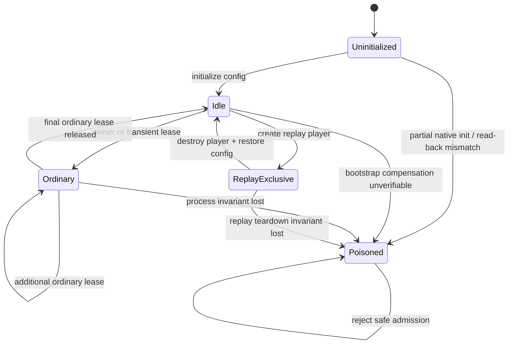
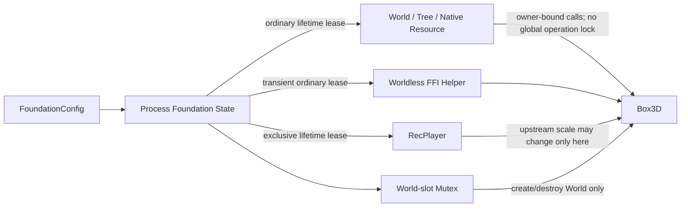
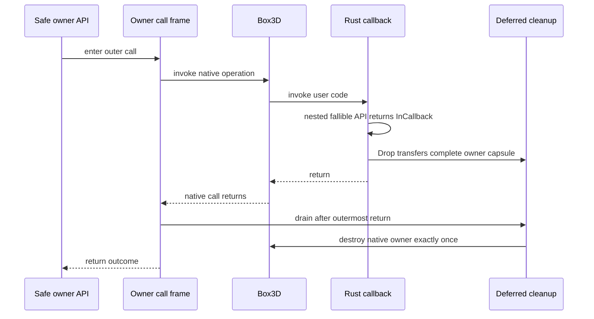
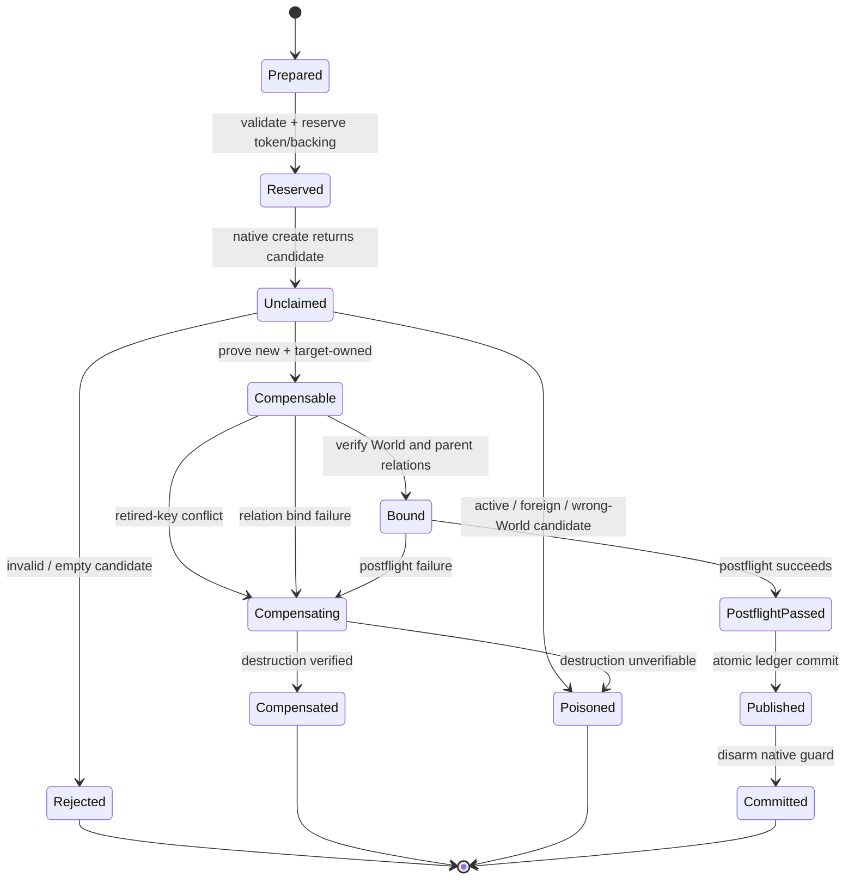

# Rebuild Foundation And Transaction Soundness - Plan

## Goal Capsule

| Field | Decision |
|---|---|
| Objective | Replace the process-wide Box3D mutex with a sound Foundation protocol, make callback-time destruction deterministic, and make every native creation either publish atomically or compensate and fail closed. |
| Authority | The checked-out `boxddd` source and the pinned Box3D clone at `repo-ref/box3d` commit `781673be801569a94be7942848755fc0baad3653` define behavior. Published tag `v0.3.0` defines the public migration and semver baseline. |
| Execution profile | This is a Deep, breaking `0.4.0` refactor. Public APIs may break and obsolete code must be deleted. Characterization and fault-injection tests precede each dangerous replacement. Rust, Bevy, WASM provider, examples, documentation, CI, and release tooling are in scope. |
| Stop conditions | Stop only when no safe entry point can race a Box3D process global, independent Worlds demonstrably overlap, callback re-entry cannot deadlock, creation faults compensate or poison deterministically, all migrated consumers build, and the complete verification contract passes or identifies a verified external prerequisite. |
| Tail ownership | Work on `refactor/foundation-transaction-soundness` with local Conventional Commits. The executor may simplify and commit autonomously. Pushing, opening a pull request, tagging, publishing, and modifying the sibling `../boxdd` checkout are excluded. |

---

## Product Contract

### Summary

`boxddd 0.3.0` has strong Rust-owned definitions, provenance handles, event retirement windows, callback panic containment, and result-first APIs. Its remaining process model is unsound and unnecessarily serial. Safe runtime setters can race ordinary C reads of global length and stall values, a non-reentrant global mutex can deadlock when callbacks enter another safe wrapper or drop an owner, and the same mutex prevents the independent-World parallelism promised by Box3D.

The creation path also stops one phase too early. It reserves Rust state before FFI, but it does not claim the returned native identity, verify its owner and parents, guard the unpublished native allocation, compensate post-call failures, or poison an owner whose native state can no longer be trusted. The existing ledger already prevents stale-handle resurrection through owner and resource tokens and preserves pending and visible event windows. This plan keeps that design and adds the missing creation-side protocol.

The replacement introduces one process-lifetime `Foundation` configuration, shared ordinary activity, exclusive replay activity, callback-aware owner call frames, deferred native cleanup, narrow World-slot serialization, and a typed creation transaction. The public break becomes the `0.4.0` migration rather than a compatibility layer over invalid behavior.

### Problem Frame

- `raw::set_length_units_per_meter` and `raw::set_stall_threshold` are safe mutable process globals. Box3D stores both in ordinary C `static float` values. Safe geometry, simulation, logging, and default-definition calls can read them concurrently, which creates a C data race and undefined behavior.
- Upstream requires length units to be set once at application startup before any Box3D call. The current replay call-scoped override deliberately mutates that global after startup and permits ordinary Worlds and differently scaled players to coexist.
- About 135 lock acquisitions serialize unrelated Worlds, standalone trees, geometry helpers, queries, event reads, file operations, and collision functions. Upstream states that independent Worlds can simulate in parallel and requires a mutex only for concurrent World creation and destruction.
- Query and traversal APIs hold the non-reentrant process mutex while invoking user code. A visitor that calls another locked helper or drops a second native owner waits forever on the same thread.
- Owner `Drop` implementations enter Box3D directly. Destruction from a callback therefore cannot return an error and cannot safely wait for the outer native call.
- Body, shape, joint, and dynamic-tree proxy creation only performs `reserve -> native create -> IsValid -> publish`. A duplicate or foreign native result can overwrite an active ledger entry in release builds, while debug builds can panic after native creation without rollback.
- `PreparedBodyDef` and `PreparedShapeDef` keep borrowed backing alive, but `lower_locked` returns a raw value whose pointers can escape the carrier by convention rather than type structure.
- `0.3.0` is published. A deliberate breaking redesign requires a `0.4.0` workspace version, a `v0.3.0` semver baseline, migration guidance, and release-profile tooling that fails closed on inventory drift.

### Actors

- A1. Core binding users who initialize process-wide units once and expect every safe wrapper to preserve that invariant.
- A2. Simulation users who create independent Worlds on different threads and expect Box3D's documented cross-World parallelism.
- A3. Callback, query, debug-draw, task-system, recording, replay, and standalone-resource users who need deterministic re-entry and destruction behavior.
- A4. Maintainers of the core crate, Bevy integration, WASM provider, examples, and release pipeline who need one testable `0.4.0` contract.

### Key Flows

- F1. An application explicitly initializes `Foundation` with validated process settings before any safe FFI, obtains scale-aware definitions from it, creates ordinary owners, and runs independent World calls concurrently without mutating process globals. Covers R1-R8 and R12-R13.
- F2. An application creates a replay player only while no ordinary owner or transient native call is active; the player owns exclusive activity until destruction restores the configured scale, and every replay-internal World rebuild uses the World-slot mutex. Covers R9-R12.
- F3. A native call enters user code; nested safe API calls reject with `InCallback`, infallible owner destruction is deferred, and cleanup runs after the outermost native call returns. Covers R14-R17.
- F4. A resource creation validates and reserves before FFI, claims and binds the returned native identity, performs postflight work, then publishes atomically. Pre-FFI failures return without native mutation; every post-native failure either rejects an empty result, compensates a proven-owned unpublished object, or poisons the affected owner. Covers R18-R25.
- F5. Core, Bevy, examples, WASM, documentation, and release tooling migrate together to one `0.4.0` surface and verification matrix. Covers R26-R29.

### Requirements

**Foundation configuration and activity**

- R1. `FoundationConfig` must own every safe mutable Box3D process setting used by this binding: finite positive length units and a finite positive stall threshold or an explicit disabled value. Validation must also reject configurations whose scale-derived Rust defaults overflow or become non-finite.
- R2. Foundation initialization must be explicit, set native globals before the first safe Box3D call, read them back before publication, be idempotent for a bitwise-identical normalized configuration, and reject a conflicting later configuration. A partial native write, read-back mismatch, or panic after the first native write must poison initialization permanently rather than publish or retry against unknown process state.
- R3. Safe runtime setters and their mutable-global documentation must be removed. Read-only configuration must come from the initialized Foundation state instead of unsynchronized native globals.
- R4. Scale-aware definitions and native default templates must come from an initialized Foundation. Remove `Default` and static builders from definitions whose values depend on Box3D process configuration; no unrelated first use may silently select the default configuration.
- R5. Every Rust binding entry point that may enter Box3D must be classified as owner-bound, ordinary owner creation, transient ordinary activity, exclusive replay activity, World-slot mutation, or intentionally unsafe raw access. Safe entries must enforce their class; unsafe raw/sys entries must document which enforcement they bypass.
- R6. Every long-lived native allocation owner whose idle state or destructor depends on Foundation configuration must retain an ordinary lease for that native lifetime. World, DynamicTree, raw World parts, owned geometry resources, Recording, and equivalent owners must each receive an explicit lifetime-or-transient classification in the FFI lifetime audit; storage-only Recording state may release ordinary activity while detached, but attached recording activity may not outlive its World lease.
- R7. Worldless safe helpers that enter Box3D without creating an owner must hold a transient ordinary lease for the complete native call.
- R8. Foundation admission must be non-blocking and fail with a typed error when exclusive and ordinary activity conflict. Safe code must not wait for an owner that the same thread may need to drop.

**Replay isolation and parallel Worlds**

- R9. `RecPlayer` must acquire exclusive Foundation activity before its first native call and retain it through native destruction and verified configured-scale restoration. Native create failure after Box3D changes scale must restore and read back the Foundation baseline before releasing exclusivity.
- R10. Replay creation must fail while any ordinary owner or transient call exists, and ordinary activity must fail while replay exists. Multiple live replay players are rejected.
- R11. Delete the call-scoped `LengthUnitsOverride` model and the `0.3.0` promise that replay players, ordinary Worlds, and runtime scale setters can interleave.
- R12. Only native World-slot creation and destruction may use the process World-slot mutex. This includes replay create, destroy, validation, and debug-callback rewiring paths that internally rebuild a World. No process-wide mutex may span World simulation, World reads, standalone tree operations, collision helpers, file helpers, or user callbacks.
- R13. `World` remains `!Send + !Sync`, but two threads that each create and own a separate World must be able to overlap native steps.

**Callback and owner lifecycle**

- R14. Every native call that may invoke Rust code must run inside an owner call frame that marks callback execution and identifies the outermost safe cleanup boundary.
- R15. A fallible safe API entered from a Box3D callback must return `Error::InCallback` before any Foundation admission, mutex acquisition, ledger mutation, or FFI call.
- R16. Infallible owner `Drop` during a callback must transfer an ownership-complete cleanup capsule to the nearest valid owner call frame. Owner-thread frames may retain non-`Send` capsules locally; process-wide queues may contain only `Send`-safe capsules. The outermost native call drains cleanup after Box3D returns and worker completion is joined. If no valid boundary can own the complete capsule, the binding intentionally retains the owner rather than making it `Send`, re-entering native code, or freeing borrowed state early.
- R17. Deferred cleanup must destroy native state exactly once, preserve sidecar and lease lifetimes through native destruction, serialize World-slot destruction, and expose no public manual-drain obligation. Fallible `close` or `finish` APIs report cleanup failures; infallible Drop poisons the narrowest surviving owner, or Foundation health when no narrower fallible boundary remains, so the next safe admission fails closed.

**Native creation transaction**

- R18. Body, shape, joint, dynamic-tree proxy, and World bootstrap creation must follow one typed phase order: prepare, reserve, native create, claim, bind, postflight, publish, commit.
- R19. Every native creation function must be audited for synchronous callbacks. A callback-capable create must install its complete callback invocation state before FFI. The pinned shape `invokeContactCreation` path is classified as callback-free during creation because it only buffers broad-phase work; its next-step callback must observe the already-published identity.
- R20. Claim must classify native output before publication. An invalid or empty result returns `Error::ObjectIdentityExhausted` with no ledger mutation or poison. An active, foreign-owner, or wrong-World identity is untrusted: do not destroy it, preserve the ledger, and poison the target owner. Only a new identity proven to belong to the target World becomes compensable; observable retired-key conflicts and wrong-parent relations are then rejected during bind and compensated under R21.
- R21. Once a returned identity is proven new and owned by the target, an uncommitted native creation guard must compensate every later failure before pending Rust backing is released.
- R22. Publication must be logically infallible and must never insert before checking identity uniqueness. Shape and joint relation updates must become one commit operation from a bound typestate.
- R23. If native compensation cannot be verified, or an untrusted active or foreign identity is returned, the affected World must become poisoned. World bootstrap compensation failure poisons Foundation activity. Poisoned owners reject later safe operations but still perform best-effort final destruction.
- R24. Existing owner/resource tokens, pending and visible event windows, ambiguity detection, and contact epochs remain authoritative. Do not add permanent tombstones; strict creation claim only blocks raw reuse while active or observable retired state exists.
- R25. Definition lowering with borrowed pointers must remain inside a prepared carrier or closure for the exact FFI call. A safe internal caller must not receive a freely movable raw definition with borrowed backing.

**Migration, documentation, and release**

- R26. World creation must be rooted in the public Foundation API. Core, Bevy, examples, tests, and provider fixtures must initialize Foundation explicitly before safe native work.
- R27. Superseded lock, scale override, setters, constructors, scale-dependent `Default` implementations, tests, and documentation must be deleted rather than retained as deprecated shims.
- R28. The workspace must advance to `0.4.0` with a fail-closed semver profile against `v0.3.0`, an exact reviewed break inventory, and an English `0.3` to `0.4` migration guide.
- R29. Native, double-precision, all-features, Bevy, WASM provider, `wasm32-wasip1`, rustdoc, Clippy, API coverage, lifetime audit, package, and semver gates must agree on the final public contract.

### Acceptance Examples

- AE1. Given custom length units and stall threshold are initialized before any other safe call, when the same configuration is initialized again, then both handles observe the same values; a different configuration returns a conflict without changing native state.
- AE2. Given Foundation is not initialized, when a safe FFI helper, World creation, replay creation, or scale-aware definition factory is requested, then it returns `FoundationUninitialized` without entering Box3D or freezing defaults.
- AE3. Given an ordinary World, DynamicTree, mesh resource, or transient geometry call is active, when replay creation is attempted, then it returns the typed busy error without calling replay FFI or changing length units.
- AE4. Given one exclusive replay player, when an ordinary owner or second player is requested, then admission fails; after player destruction, configured length units are restored and ordinary creation succeeds.
- AE5. Given two threads each construct and own one World, when both enter a deliberately synchronized step, then both native steps are simultaneously in flight and complete without a process-global operation lock.
- AE6. Given a query visitor calls a safe collision helper, when the callback executes, then the helper returns `InCallback` without blocking and the query completes.
- AE7. Given a query visitor drops a separate DynamicTree or World, when the outer query returns, then deferred cleanup destroys the native owner exactly once and releases its Foundation lease only after native destruction.
- AE8. Given a native create result collides with an active identity, when claim runs, then publication does not change, no existing native object is destroyed, the World becomes poisoned, and later operations fail closed.
- AE9. Given a shape uses `invokeContactCreation` and custom filtering, when creation returns and the next broad-phase update invokes the callback, then the callback observes the already-published Rust identity and no unknown provenance leaks from the create call.
- AE10. Given a new native shape is claimed but parent validation or postflight is fault-injected to fail, when the transaction unwinds, then the proven-owned native shape is destroyed before retained backing drops and the active ledger remains unchanged.
- AE11. Given compensation is fault-injected as unverifiable, when a later World operation runs, then it returns the poison error; dropping the World remains finite and does not double-destroy the resource.
- AE12. Given a raw key matches an ID in a pending or visible event window, when creation claim runs, then the new native object is compensated and the old event remains unambiguous until normal rotation expires it.
- AE13. Given the final `0.4.0` public surface, when release validation compares it with `v0.3.0`, then only exact reviewed break evidence passes and every core, Bevy, example, provider, documentation, and package gate uses the new API.

### Success Criteria

- No public safe function can mutate Box3D length units or stall threshold after Foundation initialization.
- A repository audit accounts for every safe FFI call and every native allocation owner under one Foundation and callback category.
- A watchdog-backed regression proves callback nesting returns rather than hanging.
- A synchronized two-World regression proves overlap, not only successful completion.
- Fault injection covers every post-native transaction boundary and demonstrates compensation ordering, atomic ledger publication, and poison behavior.
- All `0.3.0` compatibility code removed by this plan is absent from source, tests, rustdoc, examples, and migration-neutral documentation.

### Scope Boundaries

- Do not modify or update pinned Box3D commit `781673be801569a94be7942848755fc0baad3653`.
- Do not modify the sibling `../boxdd` checkout; its uncommitted branch is reference evidence only and is not an implementation dependency.
- Do not expose Box3D allocator, assertion, or log-hook configuration merely because Foundation now exists. They remain raw/sys-only until a separate ownership and callback design is approved.
- Do not make World, replay, native resources, or raw guards `Send` or `Sync` to demonstrate concurrency. Parallelism comes from separately created owners on separate threads.
- Do not preserve multiple-player coexistence, runtime global setters, `World::new`, or the global operation mutex as migration aids.
- Do not replace the current ledger with boxdd's registry or add permanent retired identities. Preserve the binding-specific event-window semantics.
- Do not claim simultaneous Foundation coordination across multiple Rust WASM consumers that share one provider instance. The current provider remains single-active-consumer unless its ABI is deliberately upgraded in a separate plan.
- Do not promise rollback of native simulation side effects after a contract-violating FFI result. Poison is the explicit containment boundary.
- Do not push, open a pull request, tag, publish, or change release credentials in this plan.

---

## Planning Contract

### Key Technical Decisions

- KTD1. Implement the complete Foundation, callback, creation, migration, and release program in one `0.4.0` branch. `(session-settled: user-approved - chosen over a narrow hotfix because the user approved all reviewed architecture repairs.)`
- KTD2. Remove invalid public contracts instead of adding deprecations or compatibility shims. `(session-settled: user-directed - chosen over source compatibility because the user explicitly authorized breaking changes and deletion.)`
- KTD3. Use one process-lifetime Foundation state initialized explicitly through a validated public configuration. Normalize the explicit disabled stall-threshold variant to the native sentinel before comparing configuration bits; identical normalized initialization is idempotent, uninitialized safe FFI fails before native entry, and later conflicts fail. Scale-dependent definitions come from Foundation factories instead of implicit `Default` initialization.
- KTD4. Model Foundation activity as a non-blocking state machine with any number of ordinary lifetime/transient leases or one exclusive replay lease. A Foundation handle is not itself a lease, so retaining a configuration handle does not prevent replay.
- KTD5. Require Foundation-rooted World and replay creation. Other native owners retain internal ordinary leases, and worldless helpers acquire transient leases without changing their established domain namespace. This keeps the process contract explicit without moving every collision function onto one oversized Foundation type.
- KTD6. Make replay exclusive for its full native lifetime. `(session-settled: user-approved - chosen over the `0.3.0` call-scoped scale override because the approved architecture freezes process configuration and treats replay's upstream scale mutation as exclusive activity.)`
- KTD7. Replace the global operation mutex with a narrow World-slot mutation mutex. Acquire Foundation activity before the slot mutex on every path, including replay internals. Owner borrowing and `!Send + !Sync` enforce per-owner access; Foundation leases protect process-global scale; Box3D's documented independent-World model governs cross-owner concurrency.
- KTD8. Reject all fallible safe API re-entry from native callbacks before admission. Do not selectively allow apparently pure collision helpers because their upstream callback and global-read assumptions are not a stable Rust safety contract.
- KTD9. Use owner call frames plus ownership-complete deferred cleanup capsules. Cleanup drains only after the outermost native call returns and worker completion is joined. A local owner-thread frame may hold non-`Send` owners; only genuinely `Send`-safe capsules may cross threads. If no claimable boundary can own the complete capsule, intentionally retain the full owner in its existing storage; never manufacture `Send`, queue a partial raw ID, re-enter native code, or destroy sidecars early.
- KTD10. Separate native creation identity trust into unclaimed and compensable states. Invalid output is a recoverable identity-exhaustion result. Active, foreign, or wrong-World output is never destroyed because it may name an existing object. Only a result proven new and target-owned arms compensation. Creation-call callback behavior is audited from pinned C source instead of inferred from API names.
- KTD11. Claim native identity trust before ledger mutation, then reject observable retired-key conflicts and bind World/parent relations, run postflight, and publish from typestate. Keep ResourceToken and event-window expiration rather than permanent tombstones. The `invokeContactCreation` path publishes before its buffered callback can run on the next step.
- KTD12. Poison the narrowest owner whose native/Rust correspondence is uncertain. World bootstrap failures that cannot be contained poison Foundation; resource failures poison only their World or standalone owner. Poison changes admission, not best-effort final cleanup.
- KTD13. Keep raw definitions and their backing in one prepared carrier and expose them only to a closure-scoped native call. This is chosen over returning raw structs and relying on local naming or lock conventions.
- KTD14. Advance directly to `0.4.0` and replace the active semver profile with a `v0.3.0` baseline after the API settles. Historical inventories may remain as release records, but current tooling must not select them for `0.4.0`.
- KTD15. Serialize source edits and all Cargo processes with `CARGO_BUILD_JOBS=1`. Read-only reviewers may run concurrently. Shared-workspace implementation agents must have disjoint files, may not commit, and may not launch Cargo; the primary executor owns integration, tests, and commits. `(session-settled: user-directed - chosen because the user authorized autonomous subagents and intermediate commits while repository instructions prohibit competing Cargo jobs.)`

### Priority Order

1. **P0 - Eliminate undefined behavior:** freeze process globals and remove safe runtime mutation before broad lock removal.
2. **P1 - Eliminate hangs and identity corruption:** add callback-aware cleanup and strict creation claim/compensation/poison.
3. **P2 - Restore upstream concurrency:** remove ordinary-operation serialization and prove independent World overlap.
4. **P2 - Complete the public break:** migrate all consumers and delete superseded APIs and internals.
5. **P2 - Make the branch releasable:** establish the `0.4.0` semver, migration, documentation, provider, and package contract.

### High-Level Technical Design

These diagrams define component ownership and state transitions. They are not prescriptive Rust implementations.

#### Foundation activity

#### Ordinary and replay ownership

#### Callback and deferred destruction

#### Creation transaction

### System-Wide Impact

- **Public API:** Adds Foundation configuration and admission errors. Removes runtime process-global setters, direct World creation, coexistence-oriented replay behavior, and obsolete raw-lock wording.
- **Native ownership:** Every FFI allocation gains an explicit Foundation lease class. Drop ordering becomes native destroy, provider/callback teardown, retained backing release, then lease release.
- **Concurrency:** Independent owners no longer share an operation mutex. World-slot creation/destruction remains serialized. Callback re-entry is rejected independently of mutex behavior.
- **Identity and events:** Creation claim becomes stricter while event observation keeps owner/resource tokens, pending/visible retirement, ambiguity detection, and contact epochs.
- **Failure propagation:** Foundation busy/config conflict, owner poison, and `Error::ObjectIdentityExhausted` become distinct recoverable categories. An empty create result leaves the owner healthy; contract-violating non-empty identities stop further safe mutation rather than being folded into `NativeFailure`.
- **Raw boundary:** Scoped raw World access relies on exclusive `&mut World` borrowing and callback checks instead of a process mutex. Unsafe structural mutation remains outside safe-ledger guarantees.
- **Consumers:** Bevy context setup, headless examples, testbed scenes, provider smoke, WASI smoke, docs, and tests must initialize or obtain Foundation consistently.
- **Release:** The workspace version and path dependency constraints move together. Semver tooling and release docs treat `v0.3.0` as the only active baseline for `0.4.0`.

### Assumptions And Resolved Questions

- The pinned Box3D statement that independent Worlds may simulate in parallel is authoritative for R12-R13.
- Box3D has no thread-affinity requirement for World destruction beyond its documented World-slot mutex. Deferred cleanup still runs only after the invoking native frame has returned.
- A Foundation handle is cheap and process-global; it does not imply ownership of native allocations and can be copied or reacquired after identical explicit initialization.
- The existing `World` `!Send + !Sync` contract stays intact. Tests create each World inside its destination thread rather than moving one across threads.
- `boxdd` patterns are advisory. Its current uncommitted branch has a known retired-key claim regression, so no code or test expectation is copied without checking `boxddd` event semantics.
- No launch-blocking product or architecture question remains. Implementation may choose private type names and file splits that preserve all R and KTD contracts.

### Risks And Mitigations

- **Hidden safe FFI path bypasses Foundation:** Generate and review a complete call-site inventory. Add an audit test or checked inventory so new wrappers must declare an admission class.
- **Deferred cleanup drops sidecars too early:** Cleanup capsules own all native IDs, callbacks, provider registrations, retained buffers, and leases. Fault tests record destruction order and exactly-once behavior.
- **Cross-thread callback has no local outer frame:** Queue only a cleanup capsule whose complete ownership graph is already `Send`-safe. Non-`Send` World state stays on its owner thread and is retained if no local frame can claim it. Never make World `Send`, queue a partial raw ID, or call native destruction from callback context.
- **Active/foreign native output cannot be compensated safely:** Do not guess. Preserve the old ledger, poison the target owner, and let full owner destruction reclaim native storage.
- **Removing the global lock exposes an upstream-global path missed by docs:** Classify every native call and inspect all vendored plain process globals before deleting the lock. Keep a narrow mutex only where upstream explicitly requires it.
- **Foundation OnceLock makes tests order-dependent:** Put first-use and conflicting-init cases in subprocesses. Keep in-process tests on one identical configuration.
- **Strict replay exclusion is disruptive:** Provide a focused migration guide with lifecycle examples and typed busy-error recovery. Do not dilute the invariant with hidden blocking.
- **Large API migration masks behavioral regressions:** Commit by coherent unit, keep Cargo serialized, run focused gates after each unit, then run the full matrix only after the surface stabilizes.
- **Provider behavior diverges from native:** Extend the existing provider-smoke route with Foundation conflict, replay exclusion, cleanup, and post-failure recovery metrics rather than creating a second harness.
- **Multiple WASM consumers bypass one coordinator:** Keep the current provider's single-active-consumer contract explicit and test sequential teardown/reinstantiation. Do not imply cross-instance concurrency without an ABI-level coordinator.

### Sources And Research

- `repo-ref/box3d/include/box3d/box3d.h:32` states that Worlds are independent and may simulate in parallel.
- `repo-ref/box3d/docs/foundation.md:215` requires a mutex only for concurrent World creation and destruction.
- `boxddd-sys/third-party/box3d/include/box3d/constants.h:8` requires length units to be set at startup before any Box3D call.
- `boxddd-sys/third-party/box3d/src/core.c:39` stores length units and stall threshold in ordinary process-global floats.
- `boxddd/src/core/box3d_lock.rs`, `boxddd/src/query.rs:627`, and `boxddd/src/collision.rs:741` expose the global-lock and callback self-deadlock shape.
- `boxddd/src/world/creation.rs`, `boxddd/src/joints/world_api.rs`, and `boxddd/src/world/ledger.rs:128` show reserve/create/publish without strict post-native claim.
- `boxddd/src/types/ids.rs`, `boxddd/src/core/provenance.rs`, and `boxddd/src/world/ledger.rs` establish the owner/resource-token and event-window design retained by KTD11.
- `docs/plans/2026-07-27-001-refactor-deepen-box3d-rust-binding-plan.md` records the original native-create compensation goal that was not fully implemented.
- `../boxdd/boxdd/src/core/foundation.rs` and adjacent creation/callback modules provide reference patterns only; the `boxdd` worktree is not an authority or write target.

---

## Implementation Units

### U1. Establish The Foundation Contract

- **Goal:** Introduce validated process initialization and ordinary/exclusive activity, and migrate every core caller directly broken by the public Foundation API while retaining the old operation mutex temporarily.
- **Requirements:** R1-R8, R26-R27; F1; AE1-AE2.
- **Dependencies:** None.
- **Files:** `boxddd/src/core/foundation.rs` (new), `boxddd/src/lib.rs`, `boxddd/src/prelude.rs`, `boxddd/src/error.rs`, `boxddd/src/core/units.rs`, `boxddd/src/core/box3d_lock.rs` (temporary admission bridge), `boxddd/src/raw.rs`, `boxddd/src/world.rs`, `boxddd/src/body.rs`, `boxddd/src/shapes.rs`, direct `boxddd/tests/**/*.rs` and `boxddd/examples/**/*.rs` consumers, `boxddd/tests/foundation.rs` (new), `boxddd/tests/raw_interop.rs`.
- **Approach:** Add the process configuration and activity state machine, exact-config idempotence, explicit uninitialized rejection, typed conflict/busy/poison errors, Foundation-rooted World creation, and internal ordinary/transient lease primitives. Capture or derive length- and stall-sensitive defaults only after initialization. Turn the existing checked lock entry into a private transitional admission bridge so no safe FFI bypasses Foundation while the mutex still exists. Remove setters, direct constructors, and scale-dependent defaults only in the same changeset that migrates their core tests and examples; the bridge is deleted in U5 and is never public compatibility surface.
- **Test Scenarios:**
  - A subprocess initializes custom values twice and observes idempotence.
  - A subprocess initializes custom values, then rejects a different length or stall value without native drift.
  - Concurrent subprocess threads initializing the same normalized bits converge on one published Foundation; different bits produce one winner and typed conflicts without a second native write.
  - Fault injection after each native setter and before/after read-back proves any partial initialization permanently poisons admission and cannot be retried as clean state.
  - A subprocess calls each safe native-entry category before initialization and receives `FoundationUninitialized` without native state change.
  - Invalid finite/range combinations, including zero, `NaN`, infinity, derived-default overflow, and an invalid zero stall threshold, fail before native initialization and do not consume first-init authority; the explicit disabled stall variant lowers to its reviewed native sentinel.
  - Ordinary and exclusive admission transitions cover zero, one, and multiple leases plus poison.
- **Verification:** Focused Foundation and raw-interop nextest targets pass in default and double precision; `CARGO_BUILD_JOBS=1 cargo check -p boxddd --tests --examples` passes. Public rustdoc states first-use and process-lifetime behavior.
- **Definition of Done:** Foundation owns all safe process settings; the mutable raw setters, direct World constructor, and scale-dependent implicit defaults are absent; all affected core callers compile on the new API; explicit initialization and uninitialized rejection have deterministic tests; no public compatibility setter remains.

### U2. Establish Callback Call Frames And Deferred Cleanup

- **Goal:** Make callback re-entry and infallible owner destruction finite before changing replay lifetimes or removing operation serialization.
- **Requirements:** R14-R17, R27; F3; AE6-AE7.
- **Dependencies:** U1.
- **Files:** `boxddd/src/core/callback_state.rs`, `boxddd/src/core/box3d_lock.rs`, `boxddd/src/core/task_system.rs`, `boxddd/src/core/material_mix_registry.rs`, `boxddd/src/world.rs`, `boxddd/src/world/body_api.rs`, `boxddd/src/world/shape_api.rs`, `boxddd/src/query.rs`, `boxddd/src/callbacks.rs`, `boxddd/src/debug_draw.rs`, `boxddd/src/dynamic_tree.rs`, `boxddd/src/shapes.rs`, `boxddd/src/recording.rs`, `boxddd/src/raw.rs`, `boxddd/tests/callback_reentrancy.rs` (new), existing callback, query, task, dynamic-tree, shape-resource, raw-parts, and recording tests.
- **Approach:** Add owner call frames around every callback-capable native entry while the existing mutex still makes the transition easy to characterize. Reject fallible callback re-entry before the transitional lock/admission bridge. Local frames retain complete non-`Send` owner capsules; cross-thread queues accept only complete `Send`-safe capsules. Model recording attachment explicitly (`Detached`, `Attached`, or `StopPending`) so a borrowed `RecordingSession` never needs a fabricated `'static` lifetime. Contain internal debug-shape create/destroy trampolines and route their failures to the owning World. Drain only after the outermost call returns, callback contexts and captures are released, and task workers are joined; poison the narrowest surviving boundary on infallible cleanup failure.
- **Test Scenarios:**
  - A watchdog subprocess proves a query visitor calling a safe collision helper returns `InCallback` before waiting and the outer query completes.
  - A visitor drops a second DynamicTree and a second World; native byte/world counts return to baseline only after the outer call returns.
  - Nested callback depth merges child cleanup into the parent and drains exactly once at the outermost frame.
  - Recording session `finish`/Drop from a callback marks stop pending and performs native stop only after return.
  - Worker callbacks can enqueue complete `Send`-safe cleanup, while a non-`Send` owner without a valid local frame is retained intact and never enters a process queue.
  - Visitor and debug-draw captures are released after the native lock, even when the callback panics or the capture owns another native allocation.
  - Internal persistent debug-shape callbacks cannot unwind across C and poison their World when Rust-side lifecycle bookkeeping fails.
- **Verification:** Callback, query, task-system, dynamic-tree, and recording tests pass with watchdog timeouts. The old mutex may still exist, but no tested callback path waits on it or performs callback-time native destruction.
- **Definition of Done:** Every callback-capable owner call has a frame; fallible re-entry rejects before locks/admission/FFI; deferred owner cleanup is ownership-complete and exactly once; no public manual drain exists.

### U3. Migrate Native Owners And Make Replay Exclusive

- **Goal:** Give every native allocation owner the correct lifetime lease and replace replay scale overrides with exclusive ownership on top of callback-safe teardown.
- **Requirements:** R5-R12, R16-R17, R26-R27; F1-F3; AE3-AE4, AE7.
- **Dependencies:** U1-U2.
- **Files:** `boxddd/src/world.rs`, `boxddd/src/dynamic_tree.rs`, `boxddd/src/recording.rs`, `boxddd/src/shapes.rs`, `boxddd/src/core/foundation.rs`, `boxddd/src/core/length_units_override.rs` (delete), `boxddd/src/core/units.rs`, `boxddd/src/lib.rs`, `boxddd/src/raw.rs`, directly affected core tests/examples, `boxddd/tests/recording.rs`, `boxddd/tests/shape_resources.rs`, `boxddd/tests/dynamic_tree.rs`, `docs/development/ffi-lifetime-audit.md`.
- **Approach:** Audit every owning pointer/ID and assign a lifetime or transient activity strategy. Transfer leases at recording attachment and raw-parts ownership boundaries. Acquire replay exclusivity before native creation, retain it through player destruction, and add a fallible close path that verifies configured-scale restoration. Explicitly restore and read back the baseline when native player creation fails after changing scale. Route replay create, destroy, validation, and debug-callback rewiring through the World-slot mutex. Use U2 frames for callback-time teardown. Remove the call-scoped override and coexistence tests in the same changeset that migrates their callers.
- **Test Scenarios:**
  - Each owner family follows its audited lifetime-or-transient classification; lifetime owners block replay until native drop, while detached storage-only owners allow replay.
  - Replay blocks ordinary owner creation and transient helpers; rejected calls do not enter FFI.
  - A second replay player is rejected without scale change.
  - Deep malformed replay data that fails after native scale mutation restores and reads back the baseline before releasing exclusivity.
  - Fallible close reports restoration failure; callback-time player Drop retains exclusivity through deferred native destruction and restoration.
  - Replay create, destroy, validation, and debug-callback rewiring serialize every internal World-slot mutation.
  - Raw World parts retain the original lease until reconstructed or destroyed.
- **Verification:** Recording, shape-resource, dynamic-tree, raw-parts, callback-cleanup, and lifetime-audit tests pass. A source inventory accounts for every native owner.
- **Definition of Done:** No `LengthUnitsOverride` or coexistence contract remains; every long-lived native owner retains a lease through native destruction; replay is the only exclusive activity; all directly affected core callers compile.

### U4. Build Strict Native Creation Transactions And Scoped Lowering

- **Goal:** Make every native ID creation publish atomically, compensate safely, poison on unverifiable native correspondence, and prevent borrowed raw definitions from escaping their backing.
- **Requirements:** R18-R25, R27; F4; AE8-AE12.
- **Dependencies:** U1-U3.
- **Files:** `boxddd/src/world/creation_transaction.rs` (new or equivalent internal module), `boxddd/src/world/creation.rs`, `boxddd/src/world/ledger.rs`, `boxddd/src/joints/world_api.rs`, `boxddd/src/dynamic_tree.rs`, `boxddd/src/world.rs`, `boxddd/src/body.rs`, `boxddd/src/shapes.rs`, `boxddd/src/joints/defs.rs`, `boxddd/src/error.rs`, directly affected tests/examples, focused unit tests in those modules, `boxddd/tests/definitions.rs`, `boxddd/tests/shape_resources.rs`, `boxddd/tests/world_destroy_and_recycle.rs`, `boxddd/tests/dynamic_tree.rs`.
- **Approach:** Introduce pending, unclaimed, compensable, bound, and committed states. Classify each pinned native create function as callback-free or callback-capable before writing its adapter. Check active and observable retired identities before mutation. Verify native World and parent relationships. Arm compensation only after identity ownership is safe to destroy. Make ledger publish consume bound state and perform one logical commit. Add World/Foundation poison admission and World-bootstrap RAII cleanup. In the same unit, replace freely returned borrowed raw values with closure- or carrier-scoped lowering and centralize repeated body/shape/joint orchestration while keeping backing ownership explicit.
- **Test Scenarios:**
  - Fault injection after native success at claim, bind, postflight, publish boundary, and commit disarm records native and backing drop order.
  - Invalid or empty output returns `ObjectIdentityExhausted`, leaves ledger and poison state unchanged, and permits a later valid creation.
  - Active duplicate and foreign output preserve the old ledger and native object, do not compensate the untrusted ID, and poison.
  - Retired-window collision compensates the proven-new resource and preserves event resolution.
  - Wrong shape body and wrong joint endpoints compensate and leave relation maps unchanged.
  - Successful body, each shape backing family, each joint family, and tree proxy publish exactly one new token.
  - A shape with `invokeContactCreation` publishes before the next-step custom-filter callback resolves its identity.
  - Compensation verification failure poisons; later operations reject; owner drop remains finite.
  - World bootstrap failure unregisters provider/callback state, destroys the World once, and releases or poisons Foundation as appropriate.
  - Body names and shape material arrays remain valid for the complete native call and cannot escape through safe internal helpers.
  - All shape backing types transfer on commit and drop on preflight or compensated failure.
  - Every joint definition validates both body handles and binds the exact returned endpoints.
  - Compile-fail or module-level type tests demonstrate that an unbound/raw prepared value cannot be published.
- **Verification:** Transaction hooks run in debug and release-test configurations. Definition, shape-resource, joint, stale/foreign/event-window, and World bootstrap suites pass without weaker expectations. Source search finds no direct `IsValid -> insert`, active-overwriting publication, `lower_locked`, or equivalent borrowed raw escape.
- **Definition of Done:** Prepared backing and raw pointers share one call scope; all native resource creates use the strict transaction; no ledger publication overwrites active state; post-native failures compensate or poison; transaction hooks cover every phase; duplicate create tails are removed.

### U5. Remove The Global Operation Lock And Prove Parallel Worlds

- **Goal:** Remove ordinary-operation serialization only after Foundation admission, callback cleanup, replay teardown, and creation rollback are independently sound.
- **Requirements:** R5-R8, R12-R17, R27; F1-F3; AE3, AE5-AE7.
- **Dependencies:** U1-U4.
- **Files:** `boxddd/src/core/box3d_lock.rs` (delete), `boxddd/src/core/foundation.rs`, `boxddd/src/core/callback_state.rs`, `boxddd/src/world.rs`, `boxddd/src/world/runtime.rs`, `boxddd/src/query.rs`, `boxddd/src/collision.rs`, `boxddd/src/events.rs`, `boxddd/src/callbacks.rs`, `boxddd/src/debug_draw.rs`, `boxddd/src/dynamic_tree.rs`, `boxddd/src/recording.rs`, `boxddd/src/raw.rs`, `boxddd/src/joints.rs`, `boxddd/src/joints/*.rs`, `boxddd/src/shapes.rs`, directly affected core tests/examples, `boxddd/tests/foundation_concurrency.rs` (new), `boxddd/tests/ffi_lifetime_inventory.rs` (new), existing callback/query/task tests, `docs/development/ffi-lifetime-audit.md`.
- **Approach:** Complete the safe-FFI inventory and replace the U1 transitional bridge with owner-bound or transient admission at each call family. Keep one World-slot mutation mutex and enforce activity-before-slot ordering for World and replay internals. Remove lock guards from simulation, reads, standalone trees, collision helpers, file helpers, and callbacks. Change raw World guards to rely on exclusive mutable borrowing, callback checks, and owner health.
- **Test Scenarios:**
  - A two-thread barrier proves separate World steps are simultaneously in native code; the test would time out under the old global mutex.
  - Concurrent World create/destroy and replay rebuild stress remains stable under the narrow slot mutex.
  - Callback watchdog and deferred-cleanup scenarios from U2 stay finite without the old mutex.
  - Every worldless helper family acquires transient admission and conflicts with live replay before FFI.
  - Raw guard borrowing prevents safe aliasing and contains no process mutex.
- **Verification:** Callback, query, debug-draw, task-system, recording, raw, concurrency, and thread-safety tests pass repeatedly. The checked FFI inventory accounts for every safe entry and source search finds no ordinary operation lock acquisition.
- **Definition of Done:** The process operation mutex and transitional admission bridge are gone; independent World overlap is proven; callback cleanup remains exactly once; every safe FFI call has explicit activity; World-slot mutation stays serialized.

### U6. Migrate Core, Bevy, Examples, And WASM Consumers

- **Goal:** Move every first-party consumer to the new Foundation lifecycle and prove native/provider behavior parity.
- **Requirements:** R26-R27, R29; F1-F3, F5; AE1-AE7, AE13.
- **Dependencies:** U1-U5.
- **Files:** residual `boxddd/tests/*.rs` and `boxddd/examples/*.rs`, `boxddd/examples/README.md`, `bevy_boxddd/src/**/*.rs`, `bevy_boxddd/tests/*.rs`, `bevy_boxddd/examples/**/*.rs`, `bevy_boxddd/README.md`, `examples-wasm/provider-smoke/**/*`, `xtask/src/main.rs`, `docs/platforms/wasm-callbacks.md`, `docs/platforms/wasm.md`.
- **Approach:** Earlier units migrate their directly affected core call sites in the same changeset as each break; this unit performs the residual core sweep and cross-crate integration. Introduce Foundation ownership at Bevy application/context roots, then pass or reacquire the identical handle where Worlds and replay are created. Update examples to teach explicit default or custom initialization and uninitialized rejection. Extend the existing provider smoke with admission conflicts, replay recovery, deferred cleanup, and the existing single-active-consumer boundary. Delete tests whose only purpose was the old lock or scale-override contract.
- **Test Scenarios:**
  - Bevy creates one Foundation-backed World per physics context and reports initialization conflicts as normal plugin errors.
  - Headless core and Bevy examples run under default Foundation without hidden runtime setters.
  - Provider smoke exercises ordinary owner conflict with replay, recovery after drop, callback re-entry rejection, and teardown/reinstantiation.
  - Provider documentation and smoke distinguish sequential same-process reinstantiation from unsupported simultaneous consumers.
  - WASI smoke creates and steps a Foundation-rooted World in default and double precision.
- **Verification:** Core/Bevy example checks, Bevy tests, provider smoke, WASI runtime smoke, and generated Pages validation use one final API.
- **Definition of Done:** No first-party code references removed constructors, setters, override types, or global-lock claims; provider and native examples demonstrate the same lifecycle.

### U7. Establish The 0.4.0 Release And Migration Contract

- **Goal:** Turn the breaking branch into a reviewable, packageable `0.4.0` development line against published `v0.3.0`.
- **Requirements:** R27-R29; F5; AE13.
- **Dependencies:** U1-U6.
- **Files:** `Cargo.toml`, `Cargo.lock`, crate manifests, `CHANGELOG.md`, `README.md`, crate READMEs, `docs/migrating-0.3-to-0.4.md` (new), `docs/development/ffi-lifetime-audit.md`, `docs/development/rustdoc-alignment.md`, `docs/development/upstream-conformance.md`, `docs/development/ci.md`, `docs/api-coverage.md`, `docs/upstream-parity/box3d-api-matrix.md`, `tools/semver_audit.py`, `tools/semver/0.4.0.tsv` (new), `tools/tests/test_semver_audit.py`, release workflows when synchronization assertions require updates.
- **Approach:** Move all workspace and path dependency versions together. Document the Foundation/replay/creation break and concise migration examples. Replace active semver profile expectations with `0.4.0` against `v0.3.0`. Generate the exact inventory only after API deletion ends, review every row, and align CI/package documentation.
- **Test Scenarios:**
  - Semver profile selects only `0.4.0 -> v0.3.0` and rejects unknown versions, unknown breaks, missing expected breaks, and non-semver tool failures.
  - Migration documentation contains no old setter, coexistence, direct World constructor, or global-lock advice except clearly marked before/after text.
  - API coverage and lifetime audit classify Foundation, replay exclusivity, owner leases, deferred cleanup, creation guards, poison, and raw boundaries.
  - Package archives contain the migration guide and final examples with correct dependency versions.
- **Verification:** Python semver tests, profile validation, cargo-semver-checks, rustdoc link checks, API coverage, and package audits pass against the published baseline.
- **Definition of Done:** Workspace is consistently `0.4.0`; `v0.3.0` is the active semver baseline; break inventory is exact; migration and audit docs match code; no release action is performed.

### U8. Simplify, Review, And Run The Complete Quality Matrix

- **Goal:** Remove transitional complexity, close review findings, and prove the final branch satisfies every contract.
- **Requirements:** R1-R29; F1-F5; AE1-AE13.
- **Dependencies:** U1-U7.
- **Files:** All changed files, tests, documentation, CI, and release artifacts in this plan.
- **Approach:** Run a behavior-preserving simplification pass over the changed architecture. Remove dead adapters, abandoned experiments, duplicate admission wrappers, stale lock vocabulary, and test-only hooks that escaped their intended configuration. Run a fresh structured code review and fix all validated P0/P1/P2 findings before final gates.
- **Test expectation:** This unit adds tests only when review finds an uncovered behavior; its primary role is final verification and cleanup.
- **Test Scenarios:**
  - Focused concurrency and transaction tests pass repeatedly and in isolation.
  - Full default, double-precision, feature, provider, WASI, docs, lint, semver, and package matrices pass from the same checkout.
  - A final source audit maps every Rust binding entry that may call Box3D and every native owner to Foundation, callback, transaction, or intentionally unsafe bypass categories.
  - Git diff contains no generated noise, temporary artifacts, compatibility shims, unrelated boxdd changes, or Compound Engineering badges.
- **Verification:** Execute every command in the Verification Contract serially with `CARGO_BUILD_JOBS=1`; record any unavailable external prerequisite with exact evidence.
- **Definition of Done:** All validated review findings are fixed; every gate passes or has a verified external prerequisite; the worktree contains only intentional branch changes; local commits are coherent and Conventional.

---

## Verification Contract

Run Cargo commands serially and set `CARGO_BUILD_JOBS=1`. Prefer `cargo nextest` for non-doctest Rust suites.

| Gate | Command | Expected evidence |
|---|---|---|
| Formatting | `cargo fmt --all -- --check` | No formatting diff. |
| Foundation focus | `CARGO_BUILD_JOBS=1 cargo nextest run -p boxddd --test foundation --test raw_interop --test recording` | Initialization, admission, replay, and removed-global behavior pass. |
| Callback/concurrency focus | `CARGO_BUILD_JOBS=1 cargo nextest run -p boxddd --test foundation_concurrency --test callback_reentrancy --test world_callbacks --test world_and_queries --test task_system` | Watchdogs return, deferred cleanup is exact, and two Worlds overlap. |
| Creation focus | `CARGO_BUILD_JOBS=1 cargo nextest run -p boxddd creation_transaction` | Every injected phase and owner family compensates, commits, or poisons as specified. |
| Creation release focus | `CARGO_BUILD_JOBS=1 cargo nextest run --release -p boxddd creation_transaction` | Release behavior preserves the same claim, compensation, atomic-publication, and poison guarantees. |
| Core workspace | `CARGO_BUILD_JOBS=1 cargo nextest run --workspace` | All default native tests pass. |
| Double precision | `CARGO_BUILD_JOBS=1 cargo nextest run --workspace --features "boxddd/double-precision boxddd-sys/double-precision"` | Foundation and transaction semantics are precision-independent. |
| All features | `CARGO_BUILD_JOBS=1 cargo nextest run --workspace --all-features` | Optional interop and serialization remain compatible. |
| Rustdoc | `CARGO_BUILD_JOBS=1 cargo test --workspace --doc` | Examples and compile-fail contracts match `0.4.0`. |
| Strict lint | `CARGO_BUILD_JOBS=1 cargo clippy --workspace --all-targets --all-features -- -D warnings` | Handwritten workspace code is warning-free. |
| Core teaching paths | `CARGO_BUILD_JOBS=1 cargo check -p boxddd --examples`; then run `hello_world`, `error_handling`, `callbacks_and_step_outcomes`, `recording_replay`, and `physics_thread` with `CARGO_BUILD_JOBS=1 cargo run -p boxddd --example <name>` | Every headless example initializes Foundation explicitly and executes the advertised path. |
| Bevy teaching paths | `CARGO_BUILD_JOBS=1 cargo check -p bevy_boxddd --examples`; `CARGO_BUILD_JOBS=1 cargo check -p bevy_boxddd --features "debug-gizmos physics-picking" --example testbed_3d`; `CARGO_BUILD_JOBS=1 cargo nextest run -p bevy_boxddd --test testbed` | Plugin and scenes initialize Foundation correctly. |
| Provider | `CARGO_BUILD_JOBS=1 cargo run -p xtask -- provider-smoke` | Browser provider reproduces admission, callback, teardown, and recovery contracts. |
| WASI default | `CARGO_BUILD_JOBS=1 cargo build -p boxddd --example wasm_smoke --target wasm32-wasip1`; `wasmtime target/wasm32-wasip1/debug/examples/wasm_smoke.wasm` | C-backed default-precision smoke completes. |
| WASI double | `CARGO_BUILD_JOBS=1 cargo build -p boxddd --example wasm_smoke --target wasm32-wasip1 --features double-precision`; `wasmtime target/wasm32-wasip1/debug/examples/wasm_smoke.wasm` | C-backed double-precision smoke completes. |
| API and FFI inventory | `CARGO_BUILD_JOBS=1 cargo nextest run -p boxddd --test api_coverage --test ffi_lifetime_inventory --test api_architecture` | Safe/raw/omitted API coverage and every Rust-to-Box3D entry/owner classification remain exhaustive. |
| Semver tool tests | `python3 -m unittest tools.tests.test_semver_audit` | Profile and exact-inventory parser fail closed. |
| Semver validation | `python3 tools/semver_audit.py --release-version 0.4.0 --validate-only` | Workspace, workflow, baseline, and inventory agree. |
| Semver audit | `python3 tools/semver_audit.py --release-version 0.4.0` | Only reviewed `v0.3.0` breaks are observed. |
| Package | Existing three-crate package and archive-audit commands from `docs/development/ci.md` | All publishable archives build with correct contents and versions. |

Optional diagnostic evidence may include ThreadSanitizer on a supported host. It does not replace the deterministic subprocess, barrier, fault-injection, or full-matrix gates.

---

## Definition of Done

- R1-R29 each map to at least one completed unit and one observable verification or documented static audit.
- F1-F5 and AE1-AE13 are represented by named tests, provider metrics, migration examples, or release-tool assertions.
- No safe runtime process-global setter, replay override, global operation mutex, direct World constructor, unchecked create publication, or borrowed raw-definition escape remains.
- Every native owner retains the correct Foundation lease through native destruction.
- Every callback-capable call has an owner call frame, and every fallible callback re-entry rejects before native work.
- Every native resource creation commits atomically, compensates a proven-owned unpublished object, or poisons without destroying an untrusted identity.
- Existing ledger provenance and event windows retain their stale/foreign/ambiguity guarantees.
- Independent World steps overlap in a deterministic regression while World-slot creation/destruction stays serialized.
- Core, Bevy, examples, provider, WASI, rustdoc, Clippy, semver, and package gates pass from the final checkout.
- The workspace and public documentation consistently describe `0.4.0` against `v0.3.0`.
- Abandoned implementations, temporary hooks, dead helpers, compatibility shims, stale tests, stale docs, generated scratch output, and unrelated changes are removed before completion.
- Changes are captured in coherent local Conventional Commits on the feature branch. No push, PR, tag, or publication occurs.
